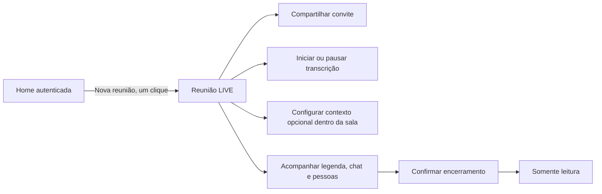
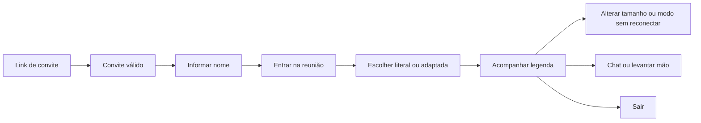

# Experiência UX/UI acessível das salas ao vivo — Plano de implementação

> **Para o Hermes:** executar este plano inline, tarefa por tarefa, sem agentes auxiliares, conforme o workflow do Semantia. Os passos usam checkboxes para rastreamento e não autorizam merge automático.

**Objetivo:** projetar, prototipar e validar a jornada completa da sala ao vivo para anfitrião e participante surdo, com a legenda como elemento central, antes de alterar o frontend de produção.

**Arquitetura:** este card cria um contrato de UX e um protótipo estático navegável no `semantia-cerebro`; não modifica Vue, API, banco ou Socket.IO. O protótipo oferece duas variantes visuais sobre a mesma máquina de estados, permitindo comparar hierarquia sem duplicar regras. A variante aprovada vira um handoff rastreável para um card/branch posterior de implementação em `semantia-web`.

**Stack:** Markdown, Mermaid, HTML semântico, CSS responsivo, JavaScript ES modules sem framework, Playwright temporário para QA real-browser, axe-core temporário para auditoria WCAG, Git/GitHub e ClickUp.

## Restrições globais

- A reunião nasce `LIVE` em um clique; não existe configuração prévia, preparação ou botão separado para iniciar.
- Contexto da plateia é opcional e configurado dentro da reunião, sem bloquear entrada, chat ou legenda.
- A legenda é o elemento visual principal da sala em todos os breakpoints.
- Google Meet é a principal referência de interação, sem copiar sua marca, cores, tipografia ou identidade visual.
- A identidade visual usa os tokens Semantia: teal `#4fb3bf`, azul `#5b86d4`, roxo `#9277cf`, superfícies claras e palco noturno.
- Português direto; controles combinam texto, ícone e estado compreensível.
- Nenhum significado depende somente de cor, animação ou som.
- Preferências individuais não reconectam nem interrompem a reunião.
- Estados futuros de IA aparecem como proposta de UX, nunca como funcionalidade entregue.
- Falha de IA mantém o literal visível e utilizável.
- Firefox/Zen é primeira classe; não recomendar troca de navegador.
- O card não inclui melhorar precisão lexical do Vosk, implementar IA, contexto persistido, preferências persistidas, WebRTC, moderação ou retenção.
- O protótipo não acessa microfone, API, Socket.IO, storage ou serviços externos.
- WCAG 2.2 AA é o mínimo; alvos interativos terão pelo menos `44×44 px` como qualidade de produto.
- Viewports obrigatórios: `390×844`, `768×1024`, `1024×768` e `1440×900`.
- Validar também zoom de 200%, teclado e `prefers-reduced-motion: reduce`.
- Não alterar `semantia-web` ou `semantia-api` neste card.
- Branch única: `docs/ux-sala-acessivel` em `semantia-cerebro`, criada a partir de `feat/salas-comunicacao`.
- PR empilhado inicialmente com base `feat/salas-comunicacao`; após o merge humano do Card 02, rebase/retarget somente com autorização e sem merge automático.
- O task operacional é `86e2j4uyj`: <https://app.clickup.com/t/90171419563/86e2j4uyj>.

---

## Correções necessárias no texto original do card

O fluxo original diz “criar sala, configurar público, compartilhar convite, iniciar”. Isso foi superado pelo aceite do Card 02. O contrato usado neste plano é:

```text
anfitrião autenticado
  → Nova reunião
  → reunião já ao vivo
  → compartilhar convite
  → iniciar/pausar transcrição quando desejar
  → configurar contexto opcional dentro da sala
  → acompanhar estado
  → encerrar
```

A configuração de contexto não é sinônimo de iniciar reunião. “Iniciar transcrição” continua sendo um controle de captura textual do anfitrião, não uma transição de ciclo de vida da sala.

---

## Diagnóstico atual que o plano deve preservar

- `AppHomeView.vue` e `RoomsView.vue` já abrem reunião instantânea por `createMeeting({})` e navegam diretamente para `/sala/:meetingId`.
- `SessionInviteView.vue` valida convite, pede nome e permite entrada sem conta.
- `LiveRoomView.vue` concentra topbar, palco, microfone, chat, pessoas, mão levantada e encerramento; ainda não possui teste dedicado da view.
- `CaptionStage.vue` já oferece parcial/final, linhas curtas, retorno ao vivo, A−/A+ e reduced motion.
- `CaptionStage.spec.ts` registra um defeito conhecido: sem valor salvo, `Number(null) === 0` pode selecionar 22 px em vez do default de 34 px. A correção pertence ao futuro card de implementação, não a este protótipo.
- `MicControl.vue` já possui seleção/teste de entrada e muitos estados técnicos; o novo contrato deve reduzir ruído sem apagar informação acionável.
- `useLiveSession.ts` expõe `offline`, `connecting` e `connected`, mas a experiência de reconexão ainda precisa de hierarquia e microcopy fechadas.
- Preferência literal/adaptada, contexto da plateia e agente de IA permanecem planejados. O protótipo pode validá-los, mas deve marcá-los como proposta.

---

## Estrutura de arquivos da entrega

### Criar

- `.hermes/plans/2026-07-31_104527-fechar-ux-sala-ao-vivo.md` — este plano.
- `produto/ux-sala-ao-vivo.md` — contrato canônico de jornadas, hierarquia, estados, copy, atalhos, responsividade, componentes e decisões.
- `prototipos/sala-ao-vivo/README.md` — como abrir, navegar, trocar variante/papel/estado e interpretar limitações.
- `prototipos/sala-ao-vivo/index.html` — protótipo semântico navegável.
- `prototipos/sala-ao-vivo/styles.css` — tokens Semantia e layouts das variantes A/B.
- `prototipos/sala-ao-vivo/prototype.js` — máquina local de cenários e interações simuladas.
- `prototipos/sala-ao-vivo/validacao.md` — protocolo, checklist WCAG, resultados automatizados e avaliação humana.
- `prototipos/sala-ao-vivo/evidencias/*.png` — screenshots aprovadas por variante e viewport.
- `prototipos/sala-ao-vivo/evidencias/axe-*.json` — relatórios axe sem violações críticas/sérias ou com justificativa explícita.

### Modificar somente após seleção da variante

- `README.md` — linkar o contrato e o protótipo aprovado.
- `contexto/historico-e-decisoes.md` — registrar data, variante escolhida, motivos, limites e participantes da validação.
- `planejamento/2026-07-29-backlog-mvp-transcricao-tempo-real.md` — atualizar Card 03 com branch, PR, evidências e estado real.
- `planejamento/2026-07-29-registro-tasks-clickup-mvp-transcricao.md` — sincronizar status/PR depois de verificar o ClickUp ao vivo.

### Mapear para implementação posterior, mas não editar neste card

- `semantia-web/src/views/LiveRoomView.vue`
- `semantia-web/src/views/LiveRoomView.spec.ts` — novo teste futuro.
- `semantia-web/src/views/SessionInviteView.vue`
- `semantia-web/src/views/SessionInviteView.spec.ts` — novo teste futuro.
- `semantia-web/src/components/live/CaptionStage.vue`
- `semantia-web/src/components/live/CaptionStage.spec.ts`
- `semantia-web/src/components/live/MicControl.vue`
- `semantia-web/src/components/live/MicControl.spec.ts`
- `semantia-web/src/components/live/ChatPanel.vue`
- `semantia-web/src/components/live/ChatPanel.spec.ts`
- `semantia-web/src/live/useLiveSession.ts`
- `semantia-web/src/live/useLiveSession.spec.ts`
- `semantia-web/src/style.css`

---

### Tarefa 1: Confirmar fonte operacional e preparar branch isolada

**Objetivo:** iniciar o card no task e branch corretos sem misturar código de produção.

**Arquivos:** nenhum arquivo alterado antes da branch.

- [ ] **Passo 1: conectar o navegador autenticado e abrir o task exato**

Abrir:

```text
https://app.clickup.com/t/90171419563/86e2j4uyj
```

Verificar após recarga:

```text
título = Fechar a experiência UX/UI acessível das salas ao vivo
responsável = Cauê Marchi Foyth
prioridade = Urgente
status atual = PENDENTE ou o estado realmente persistido
task id = 86e2j4uyj
```

Não editar se qualquer identificador divergir.

- [ ] **Passo 2: confirmar remotos, branches e limpeza**

Executar em `semantia-cerebro`:

```bash
git remote -v
git fetch origin --prune
git status --short --untracked-files=all
git branch --show-current
git rev-parse feat/salas-comunicacao
git rev-parse origin/feat/salas-comunicacao
```

Esperado: origin `Semantia-UniSenai/semantia-cerebro`, SHAs local/remoto iguais e exatamente esta única mudança não rastreada:

```text
?? .hermes/plans/2026-07-31_104527-fechar-ux-sala-ao-vivo.md
```

Qualquer outro arquivo alterado bloqueia a criação da branch até identificar sua origem.

- [ ] **Passo 3: criar a branch do card**

```bash
git switch feat/salas-comunicacao
git switch -c docs/ux-sala-acessivel
```

Esperado: branch atual `docs/ux-sala-acessivel`; API e web permanecem intocados.

- [ ] **Passo 4: versionar o plano na branch correta**

```bash
git add .hermes/plans/2026-07-31_104527-fechar-ux-sala-ao-vivo.md
git commit -m "docs(ux): planejar experiência acessível da sala ao vivo"
```

Esperado: commit contém somente o plano; `git status --short` fica vazio.

- [ ] **Passo 5: mover o task para o estado de trabalho vigente**

No ClickUp, alterar apenas o status equivalente a “EM ANDAMENTO”. Recarregar o task e confirmar status, responsável, prioridade e título.

---

### Tarefa 2: Auditar a experiência atual e preservar evidência-base

**Objetivo:** registrar o que já funciona, o que é ruído e quais lacunas o protótipo deve resolver.

**Arquivos:**
- Criar seção `Estado atual auditado` em `produto/ux-sala-ao-vivo.md`.
- Evidência temporária em `/tmp/semantia-ux-baseline/`; não commitar dados de reunião reais.

- [ ] **Passo 1: subir o build final da branch aceita do Card 02**

Validar frontend, API e banco conforme o contrato Semantia. O frontend deve usar `127.0.0.1`, não `localhost`.

- [ ] **Passo 2: capturar as jornadas atuais**

Percorrer em Firefox e Chromium:

```text
anfitrião: home → Nova reunião → Convidar → iniciar transcrição → chat → encerrar
participante: convite → nome → entrar → legenda → chat → mão → sair
encerrada: reabrir card recente → leitura sem mutação
```

Capturar `390×844`, `768×1024` e `1440×900`.

- [ ] **Passo 3: registrar achados com severidade e evidência**

Usar exatamente estas categorias:

```text
P0 — impede compreensão, entrada ou legenda
P1 — aumenta esforço ou oculta estado importante
P2 — inconsistência visual/copy sem bloquear tarefa
P3 — refinamento cosmético
```

Para cada achado: tela, papel, estado, ação, impacto, evidência e recomendação. Não avaliar apenas aparência.

- [ ] **Passo 4: registrar riscos já confirmados**

Incluir:

```text
- topbar, palco, microfone e painel lateral competem por altura em telas curtas;
- estados técnicos do ASR precisam de progressão compreensível, não de mais texto simultâneo;
- chat/pessoas precisam de comportamento explícito como painel lateral ou bottom sheet;
- preferências futuras não podem reduzir a área principal da legenda;
- reconexão e encerramento precisam preservar orientação e leitura;
- default de fonte de CaptionStage possui defeito conhecido a corrigir no card de produção.
```

- [ ] **Passo 5: commit da auditoria**

```bash
git add produto/ux-sala-ao-vivo.md
git commit -m "docs(ux): auditar experiência atual da sala ao vivo"
```

---

### Tarefa 3: Fechar jornadas e arquitetura de informação

**Objetivo:** transformar o card em fluxos observáveis e sem contradição com reunião instantânea.

**Arquivos:**
- Modificar `produto/ux-sala-ao-vivo.md`.

- [ ] **Passo 1: escrever a jornada do anfitrião**

Usar este fluxo canônico:



Critérios:

```text
- “Nova reunião” não abre modal nem formulário;
- convite fica localizável em até duas ações dentro da sala;
- contexto opcional nunca bloqueia legenda/chat;
- encerrar exige confirmação inequívoca;
- após encerrar, a pessoa entende que pode ler, mas não publicar.
```

- [ ] **Passo 2: escrever a jornada do participante convidado**



Marcar `literal/adaptada` como proposta dependente dos Cards 05, 08 e 09.

- [ ] **Passo 3: definir hierarquia de informação por papel**

Ordem obrigatória:

```text
1. legenda e estado de disponibilidade;
2. status da reunião/conexão;
3. controles essenciais do papel;
4. preferências pessoais;
5. chat/pessoas/contexto em superfície secundária;
6. ações destrutivas ou administrativas.
```

- [ ] **Passo 4: definir tarefas de usabilidade mensuráveis**

Metas de estudo, não SLA de produção:

```text
- localizar “Convidar” em até 10 s;
- identificar se a transcrição está ativa em até 5 s;
- alterar tamanho da legenda em até 15 s;
- alternar literal/adaptada em até 15 s sem sair da sala;
- retornar ao ponto ao vivo em até 5 s após reler;
- encerrar ou sair sem confundir as duas ações;
- SEQ ≥ 5/7 em cada tarefa crítica;
- nenhuma tarefa crítica abandonada por falta de compreensão do estado.
```

- [ ] **Passo 5: commit das jornadas**

```bash
git add produto/ux-sala-ao-vivo.md
git commit -m "docs(ux): mapear jornadas acessíveis da sala ao vivo"
```

---

### Tarefa 4: Fazer benchmark orientado a decisão

**Objetivo:** aprender padrões comprovados sem copiar identidade nem fazer colagem de referências.

**Arquivos:**
- Modificar `produto/ux-sala-ao-vivo.md`, seção `Benchmark e decisões`.

- [ ] **Passo 1: avaliar quatro referências atuais**

```text
Google Meet — barra de controles, side panels, convite, estados de microfone e responsividade;
Microsoft Teams — legendas, transcript e configurações de acessibilidade;
Zoom — controles de legenda, transcript e feedback de conexão;
Ava ou Web Captioner — leitura contínua, foco da fala e esforço para pessoa surda.
```

Registrar data, URL, viewport e evidência visual de cada referência.

- [ ] **Passo 2: classificar cada padrão**

Para cada padrão, preencher:

```text
padrão observado
problema que resolve
adotar / adaptar / rejeitar
como traduzir para Semantia
risco de acessibilidade
```

- [ ] **Passo 3: fechar princípios visuais**

Adotar:

```text
- barra inferior estável para ações de alta frequência;
- painel secundário não bloqueante no desktop;
- bottom sheet no mobile;
- palco escuro, tipografia clara e legenda dominante;
- status com ícone + texto + cor;
- uma ação primária por contexto;
- Semantia teal→azul→roxo apenas em ênfases, não como banho de gradiente.
```

Rejeitar:

```text
- copiar cores/ícones/logotipo do Meet;
- esconder ações críticas só em tooltip;
- cartões excessivos dentro da sala;
- vários banners simultâneos;
- depender de hover;
- abrir contexto da plateia antes da reunião;
- exibir controles futuros como se estivessem funcionais.
```

- [ ] **Passo 4: commit do benchmark**

```bash
git add produto/ux-sala-ao-vivo.md
git commit -m "docs(ux): consolidar benchmark da sala acessível"
```

---

### Tarefa 5: Especificar máquina de estados e microcopy

**Objetivo:** garantir que protótipo, testes e futura implementação usem a mesma linguagem.

**Arquivos:**
- Modificar `produto/ux-sala-ao-vivo.md`.
- Produzir o contrato consumido por `prototype.js`.

- [ ] **Passo 1: definir os cenários obrigatórios**

Usar estas chaves estáveis:

```js
export const scenarioKeys = [
  'invite-validating',
  'invite-unavailable',
  'meeting-connecting',
  'meeting-reconnecting',
  'live-empty',
  'mic-requesting',
  'mic-denied',
  'local-model-preparing',
  'local-audio-without-text',
  'live-literal',
  'live-adapted',
  'ai-unavailable-literal-fallback',
  'meeting-ended-readonly',
  'action-error',
]
```

- [ ] **Passo 2: definir o shape dos cenários**

```js
/** @typedef {'host'|'participant'} PrototypeRole */
/** @typedef {'info'|'success'|'warning'|'danger'|'neutral'} Tone */
/**
 * @typedef {Object} PrototypeScenario
 * @property {string} label
 * @property {PrototypeRole[]} roles
 * @property {string} heading
 * @property {string} message
 * @property {Tone} tone
 * @property {boolean} captionAvailable
 * @property {boolean} mutationsAllowed
 * @property {string|null} primaryAction
 */
```

- [ ] **Passo 3: fechar microcopy mínima**

Usar mensagens diretas:

```text
meeting-connecting: “Entrando na reunião…” / “Conectando com segurança.”
meeting-reconnecting: “Reconectando…” / “A legenda atual continua disponível. Novas mensagens podem atrasar.”
live-empty: “Aguardando a primeira fala” / “A reunião está ao vivo.”
mic-requesting: “Permita o microfone” / “O áudio só será usado pelo reconhecedor escolhido.”
mic-denied: “Microfone bloqueado” / “Libere a permissão do site e tente novamente.”
local-model-preparing: “Preparando transcrição em português” / “Reunião e chat continuam disponíveis.”
local-audio-without-text: “Voz detectada, aguardando texto” / “Confira a entrada se nenhuma frase aparecer.”
ai-unavailable-literal-fallback: “Modo adaptado temporariamente indisponível” / “Você continua vendo a transcrição literal.”
meeting-ended-readonly: “Reunião encerrada” / “A transcrição e o chat estão disponíveis somente para leitura.”
```

- [ ] **Passo 4: definir anúncios acessíveis**

```text
- mudanças de conexão/erro: role=status ou role=alert conforme urgência;
- legendas: aria-live=polite, sem mover foco;
- parcial não deve repetir toda a região para leitor de tela;
- abertura de painel move foco para o título; fechamento devolve ao gatilho;
- confirmação de encerramento usa dialog modal com foco preso e Escape;
- estados visuais sempre têm texto equivalente.
```

- [ ] **Passo 5: commit dos estados**

```bash
git add produto/ux-sala-ao-vivo.md
git commit -m "docs(ux): especificar estados e microcopy da sala"
```

---

### Tarefa 6: Criar o protótipo semântico e a máquina de cenários

**Objetivo:** construir um artefato navegável, offline e sem dependência do produto.

**Arquivos:**
- Criar `prototipos/sala-ao-vivo/README.md`.
- Criar `prototipos/sala-ao-vivo/index.html`.
- Criar `prototipos/sala-ao-vivo/prototype.js`.
- Criar `prototipos/sala-ao-vivo/styles.css`.

**Interface:**

```text
?variant=stage|focus
&role=host|participant
&state=<scenarioKey>
```

- [ ] **Passo 1: criar HTML semântico mínimo**

A árvore principal deve ser:

```html
<body data-variant="stage" data-role="host" data-state="live-empty">
  <a class="skip-link" href="#captions">Ir para a legenda</a>
  <main class="meeting-shell" aria-labelledby="meeting-title">
    <header class="meeting-header"></header>
    <section id="captions" class="caption-stage" aria-label="Legenda ao vivo" tabindex="-1"></section>
    <aside id="meeting-panel" class="meeting-panel" aria-labelledby="panel-title" hidden></aside>
    <nav class="control-bar" aria-label="Controles da reunião"></nav>
    <div id="meeting-status" class="status-region" role="status" aria-live="polite"></div>
  </main>
  <dialog id="end-dialog" aria-labelledby="end-dialog-title"></dialog>
  <script type="module" src="./prototype.js"></script>
</body>
```

- [ ] **Passo 2: implementar leitura segura de parâmetros**

```js
const VARIANTS = new Set(['stage', 'focus'])
const ROLES = new Set(['host', 'participant'])

function safeOption(params, key, allowed, fallback) {
  const value = params.get(key)
  return value && allowed.has(value) ? value : fallback
}

const params = new URLSearchParams(location.search)
const variant = safeOption(params, 'variant', VARIANTS, 'stage')
const role = safeOption(params, 'role', ROLES, 'host')
```

`state` deve cair em `live-empty` quando a chave não existir. Nenhum conteúdo de query string entra em `innerHTML`; usar `textContent`.

- [ ] **Passo 3: implementar interações simuladas**

```text
- alternar variante;
- alternar host/participante;
- selecionar cenário;
- abrir/fechar Chat, Pessoas, Contexto e Preferências;
- alterar tamanho da legenda;
- alternar Literal/Adaptada no papel participante;
- rolar histórico e voltar ao vivo;
- abrir/cancelar/confirmar encerramento;
- fechar painel/dialog com Escape;
- atualizar URL com history.replaceState para link profundo.
```

Nenhuma interação chama `fetch`, WebSocket, microfone ou storage.

- [ ] **Passo 4: criar README com comandos exatos**

```bash
python3 -m http.server 4174 --bind 127.0.0.1 --directory prototipos/sala-ao-vivo
```

URLs de revisão:

```text
http://127.0.0.1:4174/?variant=stage&role=host&state=live-empty
http://127.0.0.1:4174/?variant=stage&role=participant&state=live-literal
http://127.0.0.1:4174/?variant=focus&role=host&state=meeting-reconnecting
http://127.0.0.1:4174/?variant=focus&role=participant&state=ai-unavailable-literal-fallback
```

- [ ] **Passo 5: smoke estático**

```bash
node --check prototipos/sala-ao-vivo/prototype.js
python3 -m http.server 4174 --bind 127.0.0.1 --directory prototipos/sala-ao-vivo
curl -fsS http://127.0.0.1:4174/ >/dev/null
```

Esperado: sintaxe válida e HTTP 200.

- [ ] **Passo 6: commit do esqueleto navegável**

```bash
git add prototipos/sala-ao-vivo
git commit -m "feat(prototipo): estruturar sala acessível navegável"
```

---

### Tarefa 7: Implementar duas variantes de alta fidelidade

**Objetivo:** comparar decisões reais de hierarquia sem multiplicar máquinas de estado.

**Arquivos:**
- Modificar `prototipos/sala-ao-vivo/index.html`.
- Modificar `prototipos/sala-ao-vivo/styles.css`.
- Modificar `prototipos/sala-ao-vivo/prototype.js`.
- Modificar `prototipos/sala-ao-vivo/README.md`.

- [ ] **Passo 1: implementar tokens base Semantia**

```css
:root {
  --teal: #4fb3bf;
  --blue: #5b86d4;
  --purple: #9277cf;
  --ink: #1c2230;
  --ink-soft: #4d5666;
  --surface: #ffffff;
  --surface-soft: #f3f5fa;
  --night: #111728;
  --night-soft: #161e32;
  --night-line: #2c3447;
  --on-night: #f4f6fb;
  --focus: #8fc7ff;
  --danger: #e75b72;
  --success: #46d795;
  --radius-control: 14px;
  --radius-panel: 22px;
  --control-size: 48px;
  --shadow-panel: 0 24px 64px rgba(3, 8, 22, .34);
  --font-body: "Hanken Grotesk", system-ui, sans-serif;
  --font-display: "Bricolage Grotesque", "Hanken Grotesk", system-ui, sans-serif;
}
```

Fontes externas não são obrigatórias para abrir o protótipo; manter fallback de sistema.

- [ ] **Passo 2: implementar Variante A — Palco central**

Contrato visual:

```text
- cabeçalho mínimo com sair, título/status e convidar;
- legenda ocupa a maior área central;
- controles em barra inferior central;
- chat/pessoas/contexto/preferências em painel lateral de 360 px;
- painel reduz o palco apenas quando houver largura ≥ 1024 px;
- mobile usa bottom sheet, preservando legenda atrás sem perder estado.
```

Meta geométrica em `1440×900`: palco de legenda ocupa pelo menos 60% da área útil quando painel fechado.

- [ ] **Passo 3: implementar Variante B — Foco leitura**

Contrato visual:

```text
- palco de legenda em tela quase integral;
- status e título em faixa superior compacta;
- controles flutuantes inferiores;
- superfícies secundárias sempre sobrepostas, sem redimensionar a legenda;
- participante vê preferências de leitura mais próximas do palco;
- anfitrião mantém convidar e encerrar fora da sequência de controles frequentes.
```

A variante não pode esconder Chat/Pessoas/Contexto apenas em menus sem rótulo.

- [ ] **Passo 4: aplicar copy e papel contextual**

Host:

```text
Convidar · Iniciar/Pausar transcrição · Microfone · Chat · Pessoas · Contexto · Encerrar
```

Participante:

```text
Literal/Adaptada · Tamanho do texto · Voltar ao vivo · Chat · Pessoas · Levantar mão · Sair
```

Não mostrar botão de transcrição/microfone para participante sem permissão de publicar.

- [ ] **Passo 5: validar identidade própria**

Checklist visual:

```text
- nenhum verde/vermelho comunica estado sozinho;
- nenhum ícone crítico sem nome acessível/tooltip;
- não usar azul Meet como cor dominante;
- não reproduzir iconografia proprietária;
- gradiente Semantia aparece em ênfase, não em toda superfície;
- densidade de texto permanece baixa sem perder instruções acionáveis.
```

- [ ] **Passo 6: commit das variantes**

```bash
git add prototipos/sala-ao-vivo
git commit -m "feat(prototipo): criar variantes da sala ao vivo"
```

---

### Tarefa 8: Fechar responsividade, teclado e acessibilidade

**Objetivo:** tornar ambas as variantes utilizáveis nos quatro viewports e por teclado.

**Arquivos:**
- Modificar os quatro arquivos em `prototipos/sala-ao-vivo/`.
- Criar `prototipos/sala-ao-vivo/validacao.md` somente depois dos testes reais.

- [ ] **Passo 1: aplicar breakpoints e safe areas**

```css
@media (max-width: 1023px) {
  .meeting-panel {
    position: fixed;
    inset: auto 12px calc(76px + env(safe-area-inset-bottom)) 12px;
    max-height: min(68svh, 620px);
  }
}

@media (max-width: 599px) {
  .meeting-header { min-height: 56px; }
  .caption-stage { padding: 16px 14px 110px; }
  .control-bar {
    min-height: 68px;
    padding-bottom: max(10px, env(safe-area-inset-bottom));
  }
}
```

O resultado deve permanecer sem scroll horizontal em `390×844`, `768×1024`, `1024×768` e `1440×900`.

- [ ] **Passo 2: implementar foco e retorno de foco**

```js
let panelTrigger = null

function openPanel(trigger, panel) {
  panelTrigger = trigger
  panel.hidden = false
  panel.querySelector('h2, button, input, select')?.focus()
}

function closePanel(panel) {
  panel.hidden = true
  panelTrigger?.focus()
  panelTrigger = null
}
```

Dialog de encerramento usa `.showModal()`, botão cancelar recebe foco inicial e fechamento devolve foco ao gatilho.

- [ ] **Passo 3: definir ordem de tabulação**

```text
skip-link → sair → título/status sem foco → convidar → palco → preferências do palco → controles da barra → gatilhos de painel → conteúdo do painel → encerrar
```

A ordem muda por papel sem deixar controles invisíveis focáveis.

- [ ] **Passo 4: aplicar reduced motion e contraste**

```css
@media (prefers-reduced-motion: reduce) {
  *, *::before, *::after {
    animation-duration: .001ms !important;
    animation-iteration-count: 1 !important;
    scroll-behavior: auto !important;
    transition-duration: .001ms !important;
  }
}
```

Critérios:

```text
texto comum ≥ 4.5:1;
texto grande e ícones informativos ≥ 3:1;
controles/focus/bordas essenciais ≥ 3:1;
foco visível com pelo menos 2 px e contraste suficiente;
alvos interativos ≥ 44×44 px.
```

- [ ] **Passo 5: commit de acessibilidade**

```bash
git add prototipos/sala-ao-vivo
git commit -m "fix(prototipo): garantir responsividade e navegação acessível"
```

---

### Tarefa 9: Executar QA automatizado e visual real-browser

**Objetivo:** substituir avaliação complacente por evidência geométrica, comportamental e acessível.

**Arquivos:**
- Criar evidências em `prototipos/sala-ao-vivo/evidencias/`.
- Criar/atualizar `prototipos/sala-ao-vivo/validacao.md`.
- Harness temporário em `/tmp/semantia-ux-qa/`; não commitar dependências de QA no cérebro.

- [ ] **Passo 1: preparar Playwright e axe em diretório temporário**

```bash
mkdir -p /tmp/semantia-ux-qa
cd /tmp/semantia-ux-qa
pnpm init
pnpm add -D playwright-core@1.62.1 axe-core@4.12.1
```

Registrar essas versões em `validacao.md`. O harness lança os executáveis de Firefox e Chromium já disponíveis na máquina; não adiciona dependências ao `semantia-cerebro`.

- [ ] **Passo 2: executar matriz mínima**

```text
2 variantes × 2 papéis × 14 estados × 4 viewports
```

Em cada combinação crítica, assertar:

```text
- document.scrollWidth <= document.documentElement.clientWidth;
- shell, painel, dialog e barra dentro da viewport;
- palco possui área visível positiva;
- controles visíveis possuem retângulo mínimo 44×44;
- accessible name estável entre breakpoints;
- painel abre, Escape fecha e foco retorna;
- dialog prende foco e devolve ao gatilho;
- estado encerrado não expõe mutações;
- estado IA indisponível mantém literal visível;
- console sem erro e pageerror vazio;
- zero requests fora de 127.0.0.1:4174.
```

- [ ] **Passo 3: validar teclado completo**

Percorrer sem mouse:

```text
host: skip → convidar → palco → transcrição → painel → encerramento/cancelamento
participant: skip → palco → tamanho → literal/adaptada → chat → mão → sair
```

Esperado: foco sempre visível, sem armadilha fora do dialog e sem salto para conteúdo oculto.

- [ ] **Passo 4: executar axe-core**

Executar pelo menos:

```text
stage/host/live-empty
stage/participant/live-literal
focus/host/mic-denied
focus/participant/ai-unavailable-literal-fallback
ambas as variantes em meeting-ended-readonly
```

Gate: zero violações `critical` ou `serious`. Violações menores precisam de correção ou justificativa vinculada a critério WCAG.

- [ ] **Passo 5: testar zoom e reduced motion**

```text
- 200% em 1440×900 sem perda de ações ou scroll bidimensional;
- prefers-reduced-motion=reduce sem pulse/transições persistentes;
- painel e dialog continuam dentro da viewport.
```

- [ ] **Passo 6: realizar QA visual adversarial**

Avaliar:

```text
hierarquia da legenda;
densidade e legibilidade;
clipping/overflow;
contraste;
colisão com safe area de chat/VLibras;
consistência entre papéis;
clareza de parcial/final/fallback;
risco de copiar visual do Meet;
uso exagerado de cards, gradientes ou texto.
```

- [ ] **Passo 7: salvar evidências**

Nomes obrigatórios:

```text
stage-host-desktop.png
stage-participant-mobile.png
focus-host-tablet.png
focus-participant-desktop.png
stage-reconnecting-mobile.png
focus-ai-fallback-mobile.png
```

- [ ] **Passo 8: commit do QA**

```bash
git add prototipos/sala-ao-vivo
git commit -m "test(ux): registrar QA acessível dos protótipos"
```

---

### Tarefa 10: Validar entendimento e esforço com pessoas

**Objetivo:** escolher por usabilidade, não por gosto isolado.

**Arquivos:**
- Modificar `prototipos/sala-ao-vivo/validacao.md`.

- [ ] **Passo 1: fazer revisão de produto com Foyth**

Apresentar as variantes em vídeo curto e links navegáveis. Demonstrar exatamente os mesmos cenários nas duas variantes para evitar comparação enviesada.

- [ ] **Passo 2: aplicar roteiro de tarefas**

Sem orientar o caminho:

```text
1. Você recebeu um convite. Entre e diga se a reunião está ao vivo.
2. Identifique qual texto é literal e mude para adaptado.
3. Aumente a legenda e depois volte ao trecho mais recente.
4. Abra o chat e retorne à legenda.
5. Descubra o que acontece se a IA ficar indisponível.
6. Como anfitrião, compartilhe o convite e pause a transcrição.
7. Encerre a reunião sem confundir “Sair” com “Encerrar”.
```

Depois de cada tarefa, coletar sucesso, tempo, erros, comentário e SEQ de 1 a 7.

- [ ] **Passo 3: validar com pessoa surda ou intérprete quando houver disponibilidade real**

Priorizar ao menos uma pessoa surda. Se isso não for possível durante o card, registrar literalmente que houve somente revisão heurística/automatizada e de produto; não afirmar validação com o público.

Não gravar nome, voz, imagem ou conteúdo pessoal sem consentimento. Guardar somente observações necessárias.

- [ ] **Passo 4: decidir variante por critérios**

Pesos:

```text
35% compreensão da legenda/estado;
25% esforço nas tarefas;
20% acessibilidade objetiva;
10% responsividade;
10% coerência com identidade Semantia.
```

Escolher A, B ou uma composição explicitamente justificada. Não criar uma terceira variante por gosto sem evidência.

- [ ] **Passo 5: registrar aceite de produto**

O documento deve dizer:

```text
data absoluta;
participantes e papel, sem dados desnecessários;
variante escolhida;
resultados por tarefa;
problemas corrigidos;
limites não validados;
aprovação explícita de Foyth.
```

- [ ] **Passo 6: commit da decisão**

```bash
git add prototipos/sala-ao-vivo/validacao.md produto/ux-sala-ao-vivo.md
git commit -m "docs(ux): aprovar contrato visual da sala ao vivo"
```

---

### Tarefa 11: Produzir handoff exato para o frontend posterior

**Objetivo:** impedir que a futura implementação interprete o protótipo por aproximação.

**Arquivos:**
- Modificar `produto/ux-sala-ao-vivo.md`.

- [ ] **Passo 1: documentar contratos de componentes futuros**

Definir sem criar arquivos no web:

```ts
type MeetingRole = 'HOST' | 'MODERATOR' | 'PARTICIPANT' | 'GUEST'
type MeetingPanel = 'chat' | 'participants' | 'context' | 'preferences' | null
type ConnectionState = 'connecting' | 'connected' | 'reconnecting' | 'offline'
type CaptionMode = 'literal' | 'adapted'
type AdaptationState = 'idle' | 'processing' | 'available' | 'fallback-literal'
```

Mapear responsabilidades:

```text
LiveRoomView.vue — composição, papel, painel ativo e ciclo da reunião;
CaptionStage.vue — apresentação literal/adaptada, tamanho, leitura histórica e volta ao vivo;
MicControl.vue — captura/transcrição somente para quem pode publicar;
ChatPanel.vue — conversa sem roubar foco do palco;
useLiveSession.ts — conexão/reconexão/erros de ação;
componentes novos somente se a implementação comprovar que LiveRoomView ficaria grande demais.
```

- [ ] **Passo 2: mapear regressões obrigatórias do futuro card**

```text
- criar LiveRoomView.spec.ts;
- criar SessionInviteView.spec.ts;
- corrigir default 34 px em CaptionStage com RED/GREEN;
- testar papel host versus guest;
- testar painel desktop/bottom sheet mobile;
- testar foco, Escape e retorno de foco;
- testar reconexão sem apagar legenda;
- testar IA indisponível com literal preservado;
- testar ended como somente leitura;
- testar reduced motion e accessible names;
- repetir QA Chromium + Firefox no build final.
```

- [ ] **Passo 3: separar dependências de cards**

```text
Card 03: contrato e protótipo aprovados;
Card 04: persistência/contexto da plateia dentro da sala;
Card 05: preferência individual literal/adaptada;
Card 08: agente de adaptação;
Card 09: legenda literal/adaptada de produção;
Card futuro de implementação visual: shell, painéis e responsividade aprovados.
```

- [ ] **Passo 4: commit do handoff**

```bash
git add produto/ux-sala-ao-vivo.md
git commit -m "docs(ux): detalhar handoff da sala para o frontend"
```

---

### Tarefa 12: Sincronizar cérebro, PR e ClickUp sem merge

**Objetivo:** deixar o card auditável e pronto para revisão.

**Arquivos:**
- Modificar `README.md`.
- Modificar `contexto/historico-e-decisoes.md`.
- Modificar `planejamento/2026-07-29-backlog-mvp-transcricao-tempo-real.md`.
- Modificar `planejamento/2026-07-29-registro-tasks-clickup-mvp-transcricao.md`.

- [ ] **Passo 1: atualizar fonte de verdade**

Registrar somente fatos executados: branch, variante aprovada, validações, risco residual e ausência/presença de validação com pessoa surda/intérprete.

- [ ] **Passo 2: executar revisão determinística em duas passagens**

Passagem 1 — contrato:

```text
reunião instantânea;
legenda prioritária;
contexto não bloqueante;
papéis corretos;
estados futuros não prometidos;
privacidade;
WCAG;
responsividade;
copy direta.
```

Passagem 2 — adversarial:

```text
segredos;
requests externos;
dados pessoais;
cópia indevida do Meet;
controles sem nome;
estados por cor;
foco oculto;
placeholders não resolvidos;
artefatos temporários;
afirmativas sem evidência.
```

- [ ] **Passo 3: gate final do repositório**

```bash
git diff --check
git status --short
git diff --stat
git diff --name-only
node --check prototipos/sala-ao-vivo/prototype.js
```

Reexecutar o smoke HTTP, Playwright, axe e QA de teclado sobre o commit final.

- [ ] **Passo 4: commit de sincronização**

```bash
git add README.md contexto/historico-e-decisoes.md \
  planejamento/2026-07-29-backlog-mvp-transcricao-tempo-real.md \
  planejamento/2026-07-29-registro-tasks-clickup-mvp-transcricao.md
git commit -m "docs: sincronizar decisão de UX da sala acessível"
```

- [ ] **Passo 5: push verificável**

```bash
git push -u origin docs/ux-sala-acessivel
local_sha=$(git rev-parse HEAD)
remote_sha=$(git ls-remote origin refs/heads/docs/ux-sala-acessivel | cut -f1)
test "$local_sha" = "$remote_sha"
```

- [ ] **Passo 6: abrir PR empilhado**

```bash
gh pr create \
  --base feat/salas-comunicacao \
  --head docs/ux-sala-acessivel \
  --title "docs(ux): fechar experiência acessível das salas ao vivo" \
  --body-file /tmp/semantia-card03-pr.md
```

O corpo deve conter: objetivo, correção da jornada, variante selecionada, links do protótipo, matriz de evidências, WCAG, validação humana, riscos residuais e declaração “sem implementação de produção neste card”.

- [ ] **Passo 7: atualizar ClickUp e verificar persistência**

No task `86e2j4uyj`:

```text
status = EM REVISÃO
branch = docs/ux-sala-acessivel
PR = URL criada
artefatos = contrato + protótipo + evidências
validação = resumo factual
```

Recarregar e confirmar título, responsável, prioridade, status, branch, PR e descrição. Não mover para `Feito` antes da aprovação dos revisores e do aceite explícito do protótipo.

- [ ] **Passo 8: não realizar merge**

Entregar branch, PR, URL local do protótipo, screenshots e risco residual. Aguardar revisão de `@carlakeitemachado2` e `@emersonamancio1` quando as identidades GitHub/ClickUp forem resolvidas; não assumir que os handles são iguais entre plataformas.

---

## Gate de aceite do Card 03

O card pode ir para revisão quando todos os itens abaixo tiverem evidência:

- [ ] jornada instantânea corrigida e documentada;
- [ ] jornadas de anfitrião e participante completas;
- [ ] duas variantes navegáveis nos quatro viewports;
- [ ] todos os 14 estados demonstráveis por URL;
- [ ] legenda claramente dominante;
- [ ] teclado completo, foco e Escape validados;
- [ ] 200% de zoom e reduced motion validados;
- [ ] zero violações axe críticas/sérias;
- [ ] zero overflow/clipping e controles ≥ 44×44 px;
- [ ] IA indisponível mantém literal;
- [ ] reunião encerrada fica somente leitura;
- [ ] produto aprovado por Foyth com tarefa/SEQ registrados;
- [ ] validação com pessoa surda/intérprete executada ou limitação explicitamente declarada;
- [ ] contrato de handoff para produção completo;
- [ ] cérebro, PR e ClickUp sincronizados;
- [ ] nenhum código de produção alterado;
- [ ] nenhum merge automático realizado.

## Riscos e mitigação

- **Card 02 ainda não integrado à base principal:** prototipar sobre a branch aceita e usar PR empilhado; não redesenhar o fluxo escolar legado.
- **ClickUp sem sessão autenticada:** não alterar status/descrição até conectar o navegador correto e verificar o task por ID.
- **Protótipo confundido com funcionalidade real:** usar dados simulados e documentar explicitamente que IA, contexto e preferências ainda são propostas.
- **Validação sem público surdo:** não inflar a evidência; registrar a limitação e manter validação com público no Card 17 se não houver disponibilidade.
- **Imitação do Meet:** copiar padrões de interação, não identidade; usar tokens, copy e hierarquia Semantia.
- **Polimento antes de clareza:** critérios de sucesso e SEQ têm precedência sobre preferência estética.
- **Painéis reduzirem a legenda:** definir área mínima e usar overlay/bottom sheet quando necessário.
- **Estados técnicos verbosos:** usar mensagem curta + ação; detalhes técnicos ficam em ajuda expansível, não no palco.
- **Escopo invadir Cards 04/05/08/09:** prototipar esses pontos apenas como contrato; persistência e comportamento real ficam nos cards responsáveis.

## Auto-revisão do plano

- Cobertura do objetivo, problema, fluxo, regras, validações, observações e gestão: completa.
- Divergência “configurar/iniciar antes de entrar”: corrigida explicitamente.
- Arquivos e branches: exatos e limitados ao cérebro.
- Estados pedidos pelo card: todos rastreados por chave e cenário.
- Acessibilidade: WCAG, teclado, foco, contraste, target size, zoom, reduced motion e screen-reader semantics cobertos.
- Responsividade: mobile, dois tablets e desktop definidos.
- Validação de entendimento/esforço: tarefas, tempo, erro e SEQ definidos.
- Implementação de produção: deliberadamente bloqueada pelo gate de aprovação, com handoff posterior explícito.
- Placeholders vagos: nenhum; limitações são registradas como evidência, não preenchidas por suposição.
