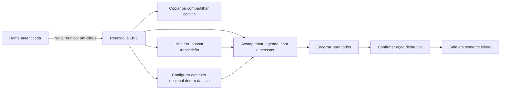
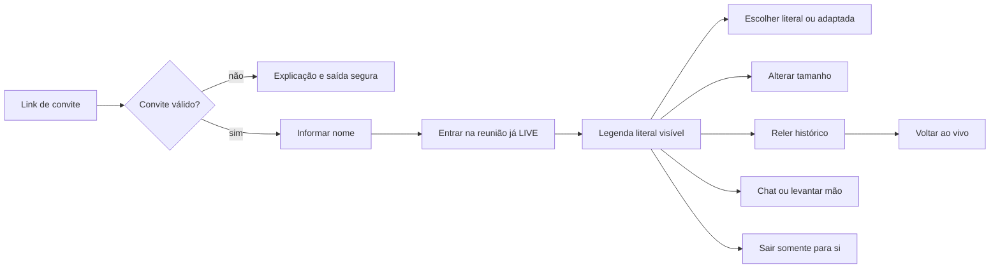
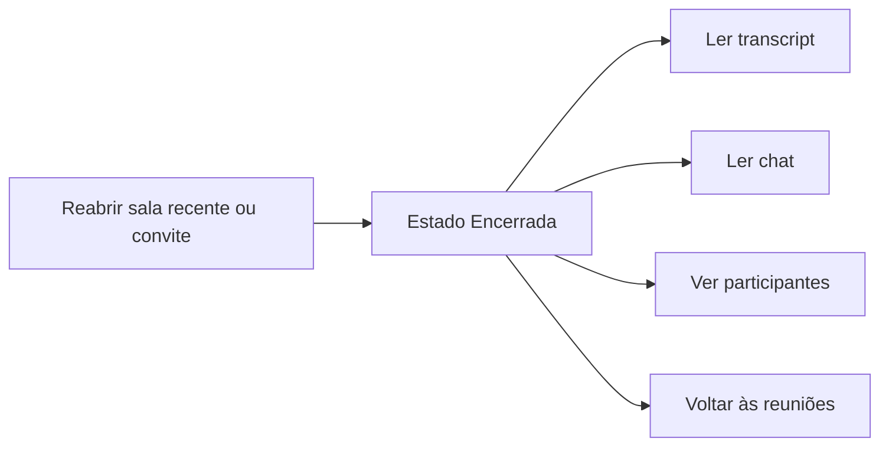

# UX da sala ao vivo — contrato e validação

> **Status em 2026-07-31:** contrato e protótipo navegável implementados na branch
> `docs/ux-sala-acessivel`; Variante A aplicada e validada no frontend real pelo
> [PR web #5](https://github.com/Semantia-UniSenai/semantia-web/pull/5). Aprovação humana final com
> pessoa surda/intérprete e leitor de tela real ainda está pendente. Este documento não declara
> contexto da plateia, preferência literal/adaptada ou agente de IA como implementados no frontend.

## Vínculos

- Card 03: [Fechar a experiência UX/UI acessível das salas ao vivo](https://app.clickup.com/t/90171419563/86e2j4uyj).
- [Contrato canônico do MVP](./contrato-mvp-transcricao-tempo-real.md).
- [Arquitetura da sala ao vivo](../arquitetura/sala-ao-vivo.md).
- [Plano de implementação](../.hermes/plans/2026-07-31_104527-fechar-ux-sala-ao-vivo.md).
- [Protótipo navegável](../prototipos/sala-ao-vivo/README.md).
- [Relatório de validação e evidências](../prototipos/sala-ao-vivo/validacao.md).

## Escopo deste card

Este card fecha a jornada, o contrato visual e os estados; o protótipo validado conduziu a aplicação
da Variante A no frontend real. Ele não implementa IA, contexto persistido, preferências persistidas,
WebRTC, moderação, retenção nem precisão lexical do ASR.

A superfície é primariamente **Monitor**: a pessoa acompanha a legenda e o estado da reunião. A barra
de ações e os painéis são uma camada secundária **Operate**. Essa ordem impede que configurações,
chat ou decoração concorram com o texto ao vivo.

## Contrato que não pode regredir

A reunião é instantânea:

```text
Nova reunião
  → reunião já LIVE
  → compartilhar convite
  → iniciar/pausar transcrição quando desejar
  → configurar contexto opcional dentro da sala
  → acompanhar legenda, pessoas e chat
  → encerrar
  → consultar conteúdo em somente leitura
```

Não fazem parte da UX ativa:

- preparação da reunião;
- formulário obrigatório antes da entrada;
- configuração de público antes de abrir;
- botão separado para iniciar a reunião;
- hierarquia visível entre sala e sessão interna.

“Iniciar transcrição” controla captura e ASR; não muda o ciclo de vida da reunião.

---

## Estado atual auditado

### Evidência observada

A auditoria considerou:

- build final da branch `feat/salas-comunicacao` servido em `127.0.0.1`;
- frontend HTTP 200, API saudável com banco conectado e modelo Vosk same-origin disponível;
- viewport desktop `1280×720` da central de áudio no Firefox;
- viewport mobile `390×844` da central de áudio no Firefox;
- captura real enviada por Foyth com transcript parcial/final sendo exibido;
- referência de controles de áudio do Google Meet fornecida por Foyth;
- componentes `LiveRoomView`, `CaptionStage`, `MicControl`, `ChatPanel` e `SessionInviteView`.

A captura real prova que microfone, ASR, Socket.IO e palco entregam texto. Frases reconhecidas com
palavras incorretas evidenciam limite lexical do modelo pt-BR; isso não é defeito de layout e foi
separado para melhoria posterior.

### O que deve ser preservado

- A legenda já ocupa a maior superfície e usa fundo escuro de alto contraste.
- A linha atual recebe mais peso que o histórico.
- A pessoa pode aumentar/diminuir texto e voltar ao ponto ao vivo.
- Estado `Ao vivo`, convite e encerramento estão visíveis no cabeçalho.
- Chat e pessoas ficam fora do palco de legenda.
- A seleção e o teste de microfone mostram dispositivo, sinal, sucesso e privacidade.
- O anfitrião e o participante já recebem ações diferentes por permissão.
- `prefers-reduced-motion` e foco visível já existem como fundação técnica.

### Escala de severidade

- **P0:** impede entrada, compreensão ou acesso à legenda.
- **P1:** aumenta muito o esforço, oculta ou comunica incorretamente um estado importante.
- **P2:** inconsistência de interação, acessibilidade ou hierarquia sem bloquear a tarefa.
- **P3:** refinamento visual ou editorial.

### Achados P0

Na auditoria inicial, nenhum P0 foi observado. No teste de usabilidade posterior, uma segunda conta
autenticada abriu convite válido, mas o frontend priorizou o JWT global em vez do token efêmero da
reunião; o gateway negou corretamente a conta sem vínculo. A correção dá precedência ao token do
convite somente para a mesma `sessionId`. O cenário foi protegido por teste RED/GREEN e smoke E2E com
duas contas, refresh, presença e chat.

### Achados P1

#### P1.1 — “Transcrição ao vivo” pode contradizer o microfone pausado

O cabeçalho do palco mantém indicador colorido e a expressão “Transcrição ao vivo” enquanto a barra
inferior informa que o microfone está pausado. A pessoa pode interpretar disponibilidade do recurso
como publicação ativa.

**Direção:** separar `Legenda disponível` de `Transcrição ativa`; usar ícone, texto e tom coerentes
para `pausada`, `preparando`, `voz detectada`, `texto confirmado`, `reconectando` e `falha`.

#### P1.2 — Estados técnicos competem com a ação principal

MicControl concentra preparação, transporte local, sinal, hipótese, erro, nível e instruções abaixo da
barra. Em telas curtas, o estado empurra o palco e exige leitura longa durante uma tarefa de alta
pressão.

**Direção:** um estado curto e acionável na barra; detalhes técnicos ficam em ajuda progressiva na
central de áudio. Nunca transformar frames em confirmação de texto.

#### P1.3 — Modal de áudio cobre o palco sem contrato completo de foco

O popover tem `role="dialog"` e fecha por Escape, mas não aplica backdrop/inert, foco inicial e retorno
de foco como um dialog modal; visualmente também se comporta como modal no mobile.

**Direção:** desktop usa popover/painel não modal quando houver espaço; mobile usa bottom sheet modal
com foco contido, título anunciado, Escape e retorno ao gatilho.

#### P1.4 — Mobile empilha palco, dialog, chat e VLibras

No mobile, a central de áudio ocupa quase toda a viewport, enquanto a entrada do chat e o widget
VLibras permanecem visíveis atrás. A pessoa perde contexto sobre qual camada está ativa e há risco de
colisão de safe area.

**Direção:** uma única superfície secundária por vez; bottom sheet acima da barra inferior, backdrop
claro e conteúdo subjacente inerte. Reservar safe area explícita para controles e VLibras.

#### P1.5 — Painel lateral permanente consome largura mesmo vazio

No desktop, Chat/Pessoas reserva cerca de 340 px quando não há conteúdo. A legenda segue grande, mas
perde área útil para uma superfície secundária vazia.

**Direção:** painel fechado por padrão ou persistido por preferência; quando aberto, Variante A
redimensiona somente em desktop largo e Variante B sobrepõe. Mobile sempre usa sheet.

#### P1.6 — Reconexão não possui orientação suficiente

A implementação distingue `connecting`, `connected` e `offline`, mas a interface atual só mostra uma
mensagem genérica. Não comunica que a legenda existente continua disponível, que conteúdo novo pode
atrasar ou qual ação é segura.

**Direção:** estado `Reconectando…` preserva transcript, bloqueia apenas mutações dependentes da
conexão e informa fallback sem remover o palco.

### Achados P2

#### P2.1 — Cabeçalho móvel dedica muito espaço a ações administrativas

Sair, identidade, convidar e encerrar ocupam duas linhas antes da legenda. Para participante, sair é
necessário; para host, convite/encerramento são menos frequentes que transcrição.

**Direção:** cabeçalho compacto; ações secundárias migram para barra/painel sem esconder rótulos.
Encerrar permanece separado visualmente de sair e das ações frequentes.

#### P2.2 — A barra atual não forma um sistema único de controles

“Iniciar transcrição” e “Entrada de áudio” são blocos largos próprios. Chat/Pessoas vivem em outra
região, e preferências de legenda ficam no topo do palco.

**Direção:** barra inferior estável com agrupamento por frequência e papel, inspirada no modelo mental
do Meet, mas com identidade e rótulos Semantia.

#### P2.3 — O vazio do palco e do chat tem pouca orientação

“Aguardando o comunicador falar…” confirma ausência de texto, mas não explica se a reunião está
conectada, se o host está transcrevendo ou se a pessoa precisa agir. O chat vazio ocupa uma coluna
inteira com pouca utilidade.

**Direção:** combinar estado de reunião e disponibilidade de legenda; fornecer uma única ação quando
ela existe. Fechar painel vazio não essencial.

#### P2.4 — Histórico não identifica origem da fala

A captura real mostra linhas fragmentadas sem informação de comunicador ou intervalo. Isso não impede
leitura, mas dificulta conversas com mais de um comunicador e revisão posterior.

**Direção:** o protótipo testa identificação discreta de comunicador sem competir com a frase atual.
A persistência dessa informação depende de contrato posterior e não é prometida neste card.

#### P2.5 — Tabs de Chat/Pessoas precisam de semântica fechada

A seleção é visual, porém o contrato precisa definir `tablist`, `tab`, `tabpanel`, `aria-selected`,
teclas de seta e estado de contagem sem depender da cor.

**Direção:** aplicar padrão WAI-ARIA Tabs quando ambas as superfícies compartilharem o mesmo painel;
se forem gatilhos independentes, usar botões com `aria-expanded` e `aria-controls`.

#### P2.6 — Preferências futuras podem virar controles falsos

Literal/adaptada, contexto e IA ainda não existem. Colocá-los no protótipo sem distinção pode ser
interpretado como entrega.

**Direção:** marcar no artefato como “proposta”; no produto real, só renderizar quando os contratos dos
Cards 04, 05, 08 e 09 existirem.

### Achados P3

- O palco usa grandes áreas escuras uniformes; hierarquia pode depender mais de tipografia e ritmo do
  que de caixas e bordas.
- Contadores `0` e `1` têm peso visual semelhante ao rótulo do painel.
- Nome da reunião e subtítulo repetem informação em alguns cenários de QA.
- A linha parcial poderia ter um sinal editorial mais distinto sem depender apenas de cor.

## Defeitos técnicos resolvidos na implementação

- `CaptionStage.vue`: o bug em que `Number(null)` trocava silenciosamente o tamanho padrão foi
  corrigido em RED/GREEN. Os passos atuais são 28/36/48 px e a ausência de preferência mantém 36 px.
- A precisão do Vosk para nomes próprios, ruído e algumas palavras segue limitada. O Card 03 não
  altera modelo nem pós-processa o literal com IA.

## Resultado da auditoria

A composição atual já prova a tese funcional, mas ainda parece uma tela técnica com regiões
justapostas. O novo contrato deve transformá-la em uma experiência de reunião **caption-first**:
legenda dominante, estado inequívoco, barra inferior estável, painel sob demanda e uma única camada
secundária por vez.

---

## Benchmark e decisões

Fontes consultadas em 2026-07-31:

- [Google Meet — layout no computador](https://support.google.com/meet/answer/10550593?hl=en): barra
  inferior sempre visível, controles frequentes centralizados, sair separado das ações próximas e
  detalhes/pessoas/chat agrupados em superfície secundária.
- [Google Meet — atalhos](https://support.google.com/meet/answer/9298571?hl=en): referência de
  descoberta de ações pelo teclado, sem assumir que uma tecla de letra seja segura no Semantia.
- [Microsoft Teams — live captions](https://support.microsoft.com/en-us/teams/meetings/use-live-captions-in-microsoft-teams-meetings):
  tamanho, cor, altura e posição personalizáveis; mudanças são individuais e aplicadas sem interromper
  a reunião.
- [Zoom — viewing captions](https://support.zoom.com/hc/en/article?id=zm_kb&sysparm_article=KB0059762):
  legenda acionável na barra, preferências pessoais, opção fixa ou destacada e ASR local em dispositivos
  elegíveis. A página oficial estava atualizada em 2026-03-19.
- [Ava — one-tap captions](https://help.ava.me/en/articles/1225757-discover-ava-app-one-tap-captions-for-instant-conversations):
  acesso rápido ao texto como núcleo do produto.
- [Ava — group conversations](https://help.ava.me/en/articles/2752252-captioning-group-conversations-on-ava):
  entrada em conversa por convite sem exigir conta.
- [WAI-ARIA APG — dialog modal](https://www.w3.org/WAI/ARIA/apg/patterns/dialog-modal/): conteúdo
  externo inerte, foco inicial interno, Tab contido, Escape e retorno de foco ao gatilho.
- [WCAG 2.2](https://www.w3.org/TR/WCAG22/): contraste, foco, reflow, teclado e alvo mínimo. O
  Semantia adota alvo de qualidade `44×44 px`, acima do mínimo AA de `24×24 px`.

### Matriz de decisão

| Referência | Padrão observado | Decisão Semantia | Motivo |
| --- | --- | --- | --- |
| Meet | barra inferior sempre visível | **Adaptar** | cria posição previsível para ações sem copiar marca ou iconografia |
| Meet | sair longe de microfone/câmera | **Adotar** | reduz erro destrutivo; no Semantia, `Encerrar` fica ainda mais separado |
| Meet | chat/pessoas/detalhes agrupados | **Adaptar** | uma superfície secundária por vez, com painel ou bottom sheet |
| Meet | rótulo principalmente por tooltip | **Rejeitar** para ações críticas | ícone, texto e estado visível têm precedência sobre hover |
| Teams | personalização individual da legenda | **Adotar** | tamanho/modo não podem mudar a experiência das demais pessoas |
| Teams | muitas opções de cor/fonte | **Postergar** | MVP oferece presets testados, evitando combinações sem contraste |
| Zoom | preferências junto da legenda | **Adotar** | reduz distância entre intenção e resultado |
| Zoom | legenda móvel e redimensionável | **Adaptar** | a Variante B testa overlay; drag livre não entra no MVP |
| Zoom | ASR local como resiliência | **Adotar conceitualmente** | é coerente com Vosk local e privacidade já implementados |
| Ava | legenda em um gesto | **Adotar** | o texto aparece sem setup do participante |
| Ava | convidado sem conta | **Preservar** | o convite atual já pede somente nome |
| APG | modal realmente inerte | **Adotar** | evita foco/interação no conteúdo que está atrás do sheet/dialog |

### Princípios visuais fechados

1. **Legenda primeiro.** Ela recebe a maior área, o maior tipo e o maior contraste.
2. **Estado antes de detalhe técnico.** A pessoa entende o que acontece e o que pode fazer; engine,
   transporte e métricas ficam na ajuda progressiva.
3. **Uma camada secundária.** Chat, pessoas, contexto ou preferências; nunca duas simultaneamente.
4. **Controle previsível.** A barra inferior não muda de lugar durante estados transitórios.
5. **Ação destrutiva isolada.** `Encerrar para todos` não fica adjacente a `Pausar transcrição`.
6. **Preferência local.** Tamanho, modo de leitura e painel aberto não interrompem reunião nem publicam
   configuração para outras pessoas.
7. **Fallback explícito.** Modo adaptado indisponível preserva o literal e não apaga histórico.
8. **Sem cor ou som isolados.** Ícone, texto e estado comunicam o mesmo significado.
9. **Sem imitação.** Teal, azul e roxo Semantia aparecem como ênfase controlada; não existe banho de
   gradiente ou cópia de controles proprietários.
10. **Firefox/Zen de primeira classe.** Falta de capability gera fallback por capacidade, nunca
    recomendação para trocar de navegador.

---

## Jornadas canônicas

### Anfitrião



#### Critérios observáveis

- `Nova reunião` não abre modal, formulário ou lobby.
- A sala está `Ao vivo` antes de contexto ou transcrição.
- `Convidar` é localizável em até 10 segundos e duas ações.
- Iniciar/pausar transcrição não desconecta participante, chat ou presença.
- Contexto é opcional e não bloqueia qualquer ação da reunião.
- `Encerrar para todos` abre dialog com foco inicial em `Cancelar`.
- O pós-reunião preserva transcript/chat e remove mutações.

### Participante convidado



`Literal/adaptada` é contrato de proposta dependente dos Cards 05, 08 e 09. Enquanto não estiver
implementado, o frontend real não deve renderizar o controle.

#### Critérios observáveis

- Convite válido pede somente nome e a ação `Entrar na reunião`.
- Entrar não pede conta, microfone ou configuração de transcrição.
- A primeira superfície útil depois da entrada é a legenda.
- Preferências são individuais e aplicadas imediatamente na apresentação.
- Abrir chat/pessoas não perde o ponto do histórico.
- `Sair da reunião` não encerra para as demais pessoas.

### Reunião encerrada



Não existem composer, levantar mão, transcrição, contexto editável ou convite ativo nesse estado.

---

## Arquitetura de informação

### Hierarquia comum

1. Legenda e disponibilidade do texto.
2. Estado da reunião e conexão.
3. Controles essenciais permitidos ao papel.
4. Preferências pessoais de leitura.
5. Chat, pessoas e contexto em superfície secundária.
6. Ações destrutivas/administrativas.

### Cabeçalho compacto

- `Sair` no início da leitura.
- Nome da reunião e `Ao vivo`, `Reconectando` ou `Encerrada` no centro lógico.
- `Convidar` somente para quem tem permissão.
- Ação destrutiva fora da sequência frequente; no mobile ela migra para `Mais ações` com rótulo
  inequívoco, mantendo confirmação.

### Palco de legenda

- É `main` da experiência, não um card decorativo dentro de outro card.
- Possui título acessível e estado de transcrição separado.
- Histórico confirmado usa peso regular; frase corrente usa maior contraste/peso.
- Texto parcial é identificado por rótulo não visual para tecnologia assistiva e indicador editorial
  além da cor.
- Preferências de leitura ficam no limite do palco, sem empurrar o texto.
- Quando a pessoa rola para trás, auto-follow pausa e surge `Voltar ao vivo`.
- Novas frases não roubam foco nem reposicionam o histórico manualmente consultado.

### Barra inferior

Ordem do anfitrião:

```text
Transcrição → entrada de áudio → Convidar → Chat → Pessoas → Contexto → Mais ações
```

Ordem do participante:

```text
Modo de leitura → tamanho → Chat → Pessoas → Levantar mão → Mais ações
```

No desktop, ícone e texto aparecem nas ações principais; ações secundárias podem usar ícone com nome
persistente na barra ou tooltip acessível. No mobile, os rótulos críticos permanecem e itens de baixa
frequência migram para `Mais ações`, sem depender de hover.

### Superfície secundária

Somente um de cada vez:

```text
chat | pessoas | contexto | preferências | ajuda de áudio | nenhum
```

- `≥ 1024 px`: painel lateral participa do layout e redimensiona o palco, sem cobrir a legenda.
- `< 1024 px`: bottom sheet modal com backdrop, conteúdo externo inerte e altura máxima de 78 svh.
- Fechar preserva estado do painel e devolve foco ao gatilho.

---

## Variantes para validação

### Variante A — Palco central

- O palco usa a coluna central e é redimensionado pelo painel apenas em desktop `≥ 1200 px`.
- Cabeçalho e barra inferior são superfícies estáveis.
- Adequada para anfitrião que acompanha controles e conteúdo simultaneamente.
- Meta em `1440×900`: palco ocupa pelo menos 60% da área útil com painel fechado.

### Variante B — Foco leitura

- Palco ocupa a viewport quase integral, sem borda externa pesada.
- Barra flutua sobre a base do palco e recolhe visualmente quando não está em foco/hover; ela nunca
  fica inacessível ao teclado.
- Painéis sempre sobrepõem e não redimensionam a linha de leitura.
- Preferências de legenda ficam mais próximas do texto.
- Adequada para participante cuja tarefa primária é acompanhar leitura contínua.

### Critério de escolha

- 35% compreensão de legenda/estado.
- 25% esforço medido por sucesso, tempo, erro e SEQ.
- 20% acessibilidade objetiva.
- 10% responsividade.
- 10% coerência Semantia.

A composição final pode combinar A/B somente quando a evidência indicar qual padrão deve variar por
papel ou largura. Não existe terceira variante por preferência estética.

---

## Máquina de estados do protótipo

### Contrato de dados

```js
/** @typedef {'host'|'participant'} PrototypeRole */
/** @typedef {'info'|'success'|'warning'|'danger'|'neutral'} Tone */
/**
 * @typedef {Object} PrototypeScenario
 * @property {string} label
 * @property {PrototypeRole[]} roles
 * @property {string} heading
 * @property {string} message
 * @property {Tone} tone
 * @property {boolean} captionAvailable
 * @property {boolean} mutationsAllowed
 * @property {string|null} primaryAction
 */
```

### Estados e microcopy

| Chave | Título | Mensagem / comportamento | Ação |
| --- | --- | --- | --- |
| `invite-validating` | Validando convite… | Confere o acesso antes de pedir o nome. | nenhuma |
| `invite-unavailable` | Este convite não está disponível | A reunião pode ter sido encerrada ou o link não é válido. | Voltar ao início |
| `meeting-connecting` | Entrando na reunião… | Conectando com segurança. | nenhuma |
| `meeting-reconnecting` | Reconectando… | A legenda atual continua disponível. Novas mensagens podem atrasar. | Tentar agora |
| `live-empty` | Aguardando a primeira fala | A reunião está ao vivo; a transcrição ainda não publicou texto. | nenhuma |
| `mic-requesting` | Permita o microfone | O áudio só será usado pelo reconhecedor escolhido. | Ver como liberar |
| `mic-denied` | Microfone bloqueado | Libere a permissão deste site e tente novamente. | Tentar novamente |
| `local-model-preparing` | Preparando transcrição em português | Reunião e chat continuam disponíveis. | nenhuma |
| `local-audio-without-text` | Voz detectada, aguardando texto | Confira a entrada se nenhuma frase aparecer. | Conferir microfone |
| `live-literal` | Transcrição literal ao vivo | Texto reconhecido sem adaptação de IA. | nenhuma |
| `live-adapted` | Modo adaptado ao vivo | A pessoa vê a apresentação adaptada; o literal segue disponível. | Ver literal |
| `ai-unavailable-literal-fallback` | Modo adaptado temporariamente indisponível | Você continua vendo a transcrição literal. | Tentar modo adaptado |
| `meeting-ended-readonly` | Reunião encerrada | Transcrição e chat estão disponíveis somente para leitura. | Voltar às reuniões |
| `action-error` | Não foi possível concluir a ação | A reunião continua ativa; tente novamente. | Tentar novamente |

### Regras de transição

- `meeting-reconnecting` não limpa transcript nem painel aberto.
- `mic-denied` bloqueia somente nova captura; sala, presença e chat continuam.
- `local-model-preparing` e `local-audio-without-text` não são sucesso de transcrição.
- `live-adapted → ai-unavailable-literal-fallback` troca apresentação sem perder literal.
- `meeting-ended-readonly` encerra mutações para ambos os papéis.
- Estado transitório nunca substitui todo o palco por spinner quando há transcript legível.
- Um único aviso de maior prioridade aparece por vez; detalhes adicionais ficam na ajuda.

---

## Comportamento da legenda e palco karaokê

### Tipografia

| Preferência | Desktop | Mobile | Uso |
| --- | ---: | ---: | --- |
| Compacta | 28 px | 24 px | maior volume de histórico |
| Padrão | 36 px | 32 px | default do novo contrato |
| Ampliada | 48 px | 40 px | leitura à distância/baixa visão |

- Altura de linha entre `1.35` e `1.5`.
- Linha de leitura limitada a aproximadamente `42–72ch`, conforme viewport.
- Preferência é individual e não altera Socket.IO ou estado da reunião.
- O futuro card corrige explicitamente o bug que hoje pode trocar o default 34 px por 22 px.

### Progressão

- Até três blocos confirmados permanecem próximos da frase corrente.
- Frase corrente tem rótulo acessível `Fala atual` e maior peso.
- Parcial pode atualizar visualmente, mas região viva anuncia somente incremento relevante ou frase
  final; não repete todo o histórico.
- Histórico mais antigo perde contraste moderadamente, nunca abaixo do mínimo de leitura.
- Auto-scroll usa movimento suave somente sem `prefers-reduced-motion`.
- Ao reler, a pessoa permanece onde escolheu e recebe botão `Voltar ao vivo` com contagem de novas
  frases quando aplicável.

### Literal e adaptada

- Controle segmentado pessoal, nunca controle do host para toda a sala.
- `Literal` é sempre acessível como fonte confiável.
- `Adaptada` mostra estado `Processando` sem apagar literal.
- Falha de IA muda para fallback literal com mensagem curta e retry opcional.
- Nenhum modo promete correção factual ou lexical do ASR.

---

## Teclado, foco e leitor de tela

### Ordem de foco

```text
Ir para a legenda
→ Sair
→ Convidar, quando permitido
→ palco
→ preferências do palco
→ controles essenciais da barra
→ gatilhos de painel
→ conteúdo do painel aberto
→ Mais ações
→ Encerrar, quando permitido
```

Conteúdo oculto não recebe foco. Ao abrir painel/sheet, foco vai para título ou primeira ação; ao
fechar, volta ao gatilho. Dialog de encerramento prende Tab/Shift+Tab, aceita Escape e começa em
`Cancelar` por ser a ação menos destrutiva.

### Atalhos normativos

- `Tab` / `Shift+Tab`: navegação sequencial.
- `Enter` / `Espaço`: ativar botão.
- `Escape`: fechar menu, painel, sheet ou dialog; não sai da reunião diretamente.
- `Seta esquerda/direita`: tabs e controle literal/adaptada.
- `Home` / `End`: primeira/última tab ou opção do controle segmentado.

O MVP **não ativa atalhos globais de letra** (`C`, `M`, `T`) nem chords customizados. Eles podem
conflitar com input de chat, navegador, layout de teclado e comandos de leitores de tela. Uma futura
preferência de atalhos deve ser opt-in, detectável e testada em Firefox/Zen e tecnologia assistiva.

### Regiões acessíveis

- `main`: sala e palco.
- `aria-live="polite"`: status de conexão e incremento final da legenda, em regiões separadas.
- `role="alert"`: somente erro que exige ação imediata.
- `nav aria-label="Controles da reunião"`: barra inferior.
- Painel lateral: `aside` nomeado; sheet modal: `dialog` real.
- Chat/Pessoas no mesmo contêiner: padrão APG Tabs completo.
- Contadores possuem nome como `Chat, nenhuma mensagem` e `Pessoas, 3 participantes`.

---

## Responsividade

### `1440×900`

- palco central dominante;
- barra com ícone + texto nas ações primárias;
- painel de 360–400 px sem cobrir barra;
- Variante A redimensiona; Variante B sobrepõe.

### `1024×768`

- painel sobreposto em ambas as variantes;
- cabeçalho mantém uma linha;
- barra compacta ações secundárias em `Mais ações`;
- não reduzir palco abaixo da largura de leitura.

### `768×1024`

- sheet em vez de painel fixo;
- palco ocupa toda a largura;
- barra inferior permite agrupamento/scroll horizontal interno apenas se cada ação continuar
  alcançável e houver indicação; preferência é usar `Mais ações`.

### `390×844`

- cabeçalho compacto de até 64 px;
- palco sem moldura externa redundante;
- padding inferior reserva barra e `env(safe-area-inset-bottom)`;
- sheet termina acima da barra e do VLibras;
- um controle primário com rótulo por papel;
- nenhum scroll horizontal da página.

### Zoom 200%

A experiência deve fazer reflow para equivalência mobile: sem scroll bidimensional, ações preservadas,
painel como sheet e frase corrente visível. Controles não podem ser cortados por altura fixa.

---

## Critérios WCAG 2.2 AA e qualidade Semantia

- texto comum `≥ 4.5:1`; texto grande e componentes essenciais `≥ 3:1`;
- foco visível com contorno de pelo menos 2 px e área distinguível;
- todas as tarefas operáveis por teclado;
- skip link para legenda;
- alvos interativos `≥ 44×44 px` como padrão de produto;
- nomes, papéis, estados e valores programáticos;
- erros identificados em texto e associados à ação de recuperação;
- status não rouba foco;
- reflow a 320 CSS px equivalente e zoom de 200%;
- `prefers-reduced-motion: reduce` elimina pulse, smooth scroll e transições persistentes;
- nenhuma dependência exclusiva de cor, som, hover, posição ou animação;
- dialog modal somente quando o conteúdo externo estiver realmente inerte;
- linguagem direta em pt-BR e ação primária com verbo específico.

---

## Tarefas de validação

Metas do estudo, não SLA de produção:

| Tarefa | Meta |
| --- | --- |
| localizar `Convidar` | até 10 s |
| identificar se a transcrição está ativa | até 5 s |
| alterar tamanho | até 15 s |
| alternar literal/adaptada | até 15 s, sem sair |
| voltar ao trecho ao vivo | até 5 s |
| abrir chat e retornar à legenda | sem perder ponto de leitura |
| diferenciar sair/encerrar | nenhuma ação destrutiva acidental |
| entender fallback da IA | afirmar que o literal continua visível |

Registrar sucesso, tempo, erros, comentário e SEQ de 1 a 7 após cada tarefa. Meta: SEQ `≥ 5` e
nenhuma tarefa crítica abandonada por incompreensão do estado.

---

## Handoff para implementação futura

Este card não altera os arquivos abaixo, mas fecha suas responsabilidades:

```ts
type MeetingRole = 'HOST' | 'MODERATOR' | 'PARTICIPANT' | 'GUEST'
type MeetingPanel = 'chat' | 'participants' | 'context' | 'preferences' | 'audio-help' | null
type ConnectionState = 'connecting' | 'connected' | 'reconnecting' | 'offline'
type CaptionMode = 'literal' | 'adapted'
type AdaptationState = 'idle' | 'processing' | 'available' | 'fallback-literal'
```

- `LiveRoomView.vue`: composição, papel, painel ativo e ciclo da reunião.
- `CaptionStage.vue`: literal/adaptada, tamanho, histórico, auto-follow e volta ao vivo.
- `MicControl.vue`: captura/transcrição e ajuda de áudio somente para quem pode publicar.
- `ChatPanel.vue`: conversa sem roubar foco do palco.
- `useLiveSession.ts`: conexão, reconexão e erro de ação sem apagar conteúdo.
- Novos componentes surgem apenas se testes mostrarem responsabilidade grande demais na view.

### Regressões obrigatórias do futuro card

- criar `LiveRoomView.spec.ts` e `SessionInviteView.spec.ts`;
- corrigir default de fonte em `CaptionStage` em RED/GREEN;
- testar host versus guest;
- testar painel desktop e sheet mobile;
- testar foco, Escape e retorno ao gatilho;
- testar reconexão sem apagar legenda;
- testar fallback literal quando IA estiver indisponível;
- testar encerrada como somente leitura;
- testar reduced motion, nomes acessíveis e 200% de zoom;
- repetir QA Chromium e Firefox/Zen no build final.

## Limites de validação

O contrato e o protótipo podem ser aprovados por produto e por auditoria automatizada/heurística. Só
registrar validação com pessoa surda ou intérprete quando a sessão realmente acontecer. Na ausência
dessa pessoa durante o card, declarar a limitação e manter a atividade humana no Card 17, sem fabricar
aceite do público.

## Direção técnica após o QA

A recomendação técnica preliminar é usar a **Variante A — Palco central** como base do handoff e
incorporar da Variante B o palco mais aberto em telas estreitas. Ela não equivale a aprovação de
produto. A decisão final depende da revisão das duas variantes pelo Foyth e deve ser registrada aqui
antes de qualquer alteração no frontend Vue.
