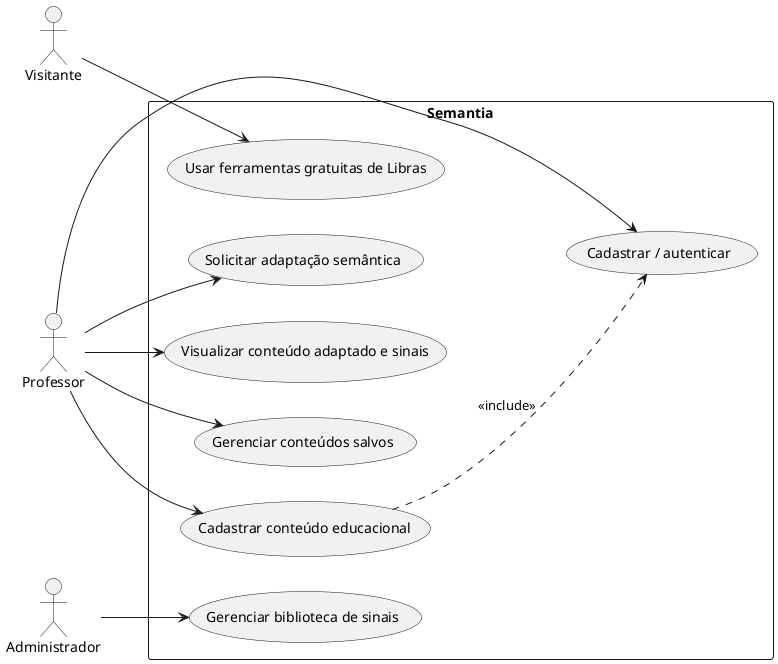

# Desafio Interdisciplinar — Semantia

> **STATUS HISTÓRICO — SUPERADO.** Este documento retrata a entrega de junho de 2026 e preserva
> o que foi apresentado naquela fase. Afirmações como “frontend-only”, “API planejada” e o
> domínio centrado em professor/aluno não descrevem o sistema nem o produto atuais. Não atualizar
> este snapshot para parecer contemporâneo: consulte o
> [contrato canônico](../produto/contrato-mvp-transcricao-tempo-real.md) e os
> [requisitos atuais](../requisitos/mvp-transcricao-tempo-real.md).

> **Nota de escopo (honestidade técnica).** Este documento mapeia o projeto **Semantia** nas
> etapas do Desafio Interdisciplinar. O Semantia hoje é um **hub web funcional (frontend)** com
> ferramentas reais de acessibilidade em Libras. As partes que o desafio exige mas que ainda
> **não estão implementadas** (backend, banco relacional, CRUD persistido) aparecem marcadas
> como **[PLANEJADO]** — com modelagem pronta para serem construídas. Nada aqui finge existir.

---

## Capa

- **Instituição:** UniSenai — Joinville
- **Curso:** Análise e Desenvolvimento de Sistemas (ADS) — 2026/1
- **Atividade:** Desafio Interdisciplinar — Tecnologia Aplicada à Solução de Problemas Reais
- **Projeto:** **Semantia** — Plataforma Web de Acessibilidade em Libras
- **Slogan:** *"Inclusão não é adaptação, é o padrão."*
- **Equipe (3 integrantes):** _[preencher — Cauê + 2]_
- **Professores:** Emerson Amancio e Tiago Ricaldi
- **Local / Data:** Joinville, junho de 2026

---

## Etapa 1 — Investigação do Problema

### 1.1 Descrição do problema
Pessoas surdas têm na **Libras** (Língua Brasileira de Sinais) sua primeira língua — uma língua
visual-espacial, com gramática própria, **diferente do português**. No ambiente educacional, a
maior parte do material (textos, slides, apostilas) é produzida só em português escrito, que para
muitos surdos é uma **segunda língua** de domínio parcial. O resultado é uma barreira de
compreensão: o conteúdo existe, mas não chega de forma acessível.

As ferramentas mais conhecidas (VLibras, Hand Talk) fazem **tradução literal**, palavra por
palavra, o que gera interpretações pouco naturais e não foram pensadas para o **professor
adaptar material didático**. Além disso, há forte dependência de **intérpretes humanos**, nem
sempre disponíveis, e o professor que quisesse aprender Libras levaria ~2 anos para fluência.

### 1.2 Quem é afetado
- **Estudantes surdos** — principal público impactado pela falta de material acessível.
- **Professores** (rede pública e privada) que não dominam Libras e precisam incluir alunos surdos.
- **Intérpretes de Libras** — sobrecarregados, sem ferramentas de apoio à preparação de material.
- **Instituições de ensino** — obrigadas por lei a garantir acessibilidade, sem recurso prático.
- **Famílias e comunidade ouvinte** que convive com pessoas surdas e quer se comunicar.

### 1.3 Justificativa
- **Lei nº 10.436/2002** reconhece a Libras como língua oficial; o **Decreto 5.626/2005** obriga
  acessibilidade educacional — existe respaldo legal e dever institucional.
- **~10 milhões** de brasileiros têm algum grau de deficiência auditiva; **~2,7 milhões** com surdez
  profunda (IBGE). É um público grande e historicamente sub-atendido.
- Reduzir a barreira comunicacional na educação tem impacto direto em **inclusão, permanência e
  desempenho** escolar — um problema **real, local e socialmente relevante**, alinhado ao tema
  "inclusão social" sugerido no desafio.

### 1.4 Evidências coletadas
- **Secundárias (já reunidas):** dados do IBGE; artigo científico **CINTED-UFRGS / RENOTE v18 n1
  (2020)** — "Um Recurso Colaborativo para apoiar Comunicação entre Surdos e Ouvintes" (UDESC),
  que confirma a lacuna e mapeia ferramentas correlatas (ECCA, AraBoard, AssistLIBRAS).
- **Primária — [A COLETAR pela equipe]:** o desafio exige **pelo menos uma evidência primária**
  (entrevista, formulário, observação ou relato do público). **Ação:** aplicar um **formulário curto
  (Google Forms)** com professores e/ou uma **entrevista de 5–10 min** com um estudante surdo ou
  intérprete da própria UniSenai, e anexar o print/registro aqui. *Não inventamos esse dado.*

---

## Etapa 2 — Levantamento de Requisitos

### 2.1 Requisitos Funcionais

| ID | Requisito | Status |
|----|-----------|--------|
| RF01 | Cadastro e autenticação de usuário (professor / administrador) | [PLANEJADO] |
| RF02 | Cadastrar conteúdo educacional em texto | [PLANEJADO] |
| RF03 | Solicitar a adaptação semântica de um conteúdo | [PLANEJADO] |
| RF04 | Exibir o conteúdo adaptado em glosas (estrutura da Libras) | [PLANEJADO] |
| RF05 | Relacionar cada glosa a um sinal da biblioteca (vídeo) | [PLANEJADO] |
| RF06 | Listar, consultar, editar e excluir conteúdos salvos (CRUD) | [PLANEJADO] |
| RF07 | Gerenciar a biblioteca de sinais — admin (CRUD) | [PLANEJADO] |
| RF08 | Tradutor de texto para Libras com avatar 3D (VLibras) | **IMPLEMENTADO** |
| RF09 | Dicionário de sinais por palavra, com vídeo (Spread the Sign) | **IMPLEMENTADO** |
| RF10 | Datilologia interativa — alfabeto manual sincronizado ao vídeo | **IMPLEMENTADO** |
| RF11 | Conteúdos de apoio: FAQ, guia do professor, mapa de recursos, sinal do dia | **IMPLEMENTADO** |

### 2.2 Requisitos Não Funcionais
- **RNF01 — Acessibilidade:** HTML semântico, navegação por teclado, foco visível, contraste,
  `prefers-reduced-motion`. *(parcialmente implementado no hub)*
- **RNF02 — Responsividade:** layout adaptável a desktop e mobile. *(implementado)*
- **RNF03 — Segurança:** senhas com hash (bcrypt/argon2); dados de usuário protegidos. [PLANEJADO]
- **RNF04 — Persistência:** dados em banco relacional PostgreSQL. [PLANEJADO]
- **RNF05 — Versionamento:** código em Git/GitHub (org `Semantia-UniSenai`). *(implementado)*
- **RNF06 — Usabilidade:** interface simples, visual-first (público com Libras como L1).

### 2.3 Regras de Negócio

| ID | Regra |
|----|-------|
| RN01 | As ferramentas gratuitas de Libras são acessíveis **sem login** (uso público). |
| RN02 | Cadastrar e salvar conteúdo educacional **exige autenticação**. |
| RN03 | Cada conteúdo pertence a **um único usuário**; só o dono pode editar/excluir. |
| RN04 | A biblioteca de sinais só pode ser **gerenciada por administrador**. |
| RN05 | Uma glosa pode **não ter** sinal correspondente — nesse caso, usa-se a datilologia (soletração). |
| RN06 | A adaptação **preserva o texto original** (operação não destrutiva; versionável). |
| RN07 | O **e-mail é único** por usuário. |

### 2.4 Principais funcionalidades
1. **Ferramentas gratuitas de Libras** (públicas, já no ar) — tradutor, dicionário, datilologia,
   sinal do dia, FAQ, guia do professor, mapa de recursos.
2. **Adaptação semântica de conteúdo** (núcleo do projeto) — transforma um texto em glosas na
   lógica da Libras e relaciona a sinais. *(em construção — coração técnico)*
3. **Gestão de conteúdos e biblioteca de sinais** — CRUD persistido. [PLANEJADO]

---

## Etapa 3 — Modelagem da Solução

### 3.1 Diagrama de Casos de Uso

**Atores:** Visitante (público), Professor (autenticado), Administrador.

| ID | Caso de uso | Ator |
|----|-------------|------|
| UC01 | Usar ferramentas gratuitas de Libras (tradutor, dicionário, datilologia…) | Visitante |
| UC02 | Cadastrar / autenticar usuário | Professor, Admin |
| UC03 | Cadastrar conteúdo educacional | Professor |
| UC04 | Solicitar adaptação semântica do conteúdo | Professor |
| UC05 | Visualizar conteúdo adaptado (glosas) e sinais relacionados | Professor |
| UC06 | Gerenciar conteúdos salvos — consultar, editar, excluir (CRUD) | Professor |
| UC07 | Gerenciar biblioteca de sinais — criar, editar, excluir (CRUD) | Administrador |

Representação (PlantUML — colar em plantuml.com para gerar a imagem):



### 3.2 Modelo Entidade-Relacionamento (MER)

Entidades e relacionamentos do banco relacional (PostgreSQL):

- **usuario** (1) —< **conteudo_educacional** (N): um usuário cria vários conteúdos.
- **conteudo_educacional** (1) —< **adaptacao** (N): um conteúdo pode ter várias versões de adaptação.
- **adaptacao** (1) —< **glosa** (N): uma adaptação é uma sequência ordenada de glosas.
- **sinal** (1) —< **glosa** (N): um sinal pode ser referenciado por várias glosas (relação opcional).
- **usuario** (N) >—< **sinal** (N) via **favorito**: usuário favorita sinais.

| Entidade | Atributos principais |
|----------|----------------------|
| **usuario** | id (PK), nome, email (único), senha_hash, papel (professor/admin), criado_em |
| **conteudo_educacional** | id (PK), usuario_id (FK), titulo, texto_original, disciplina, criado_em, atualizado_em |
| **adaptacao** | id (PK), conteudo_id (FK), texto_glosado, criado_em |
| **glosa** | id (PK), adaptacao_id (FK), ordem, termo, sinal_id (FK, opcional) |
| **sinal** | id (PK), termo, video_url, descricao, fonte, criado_em |
| **favorito** | id (PK), usuario_id (FK), sinal_id (FK) |

Esboço em SQL (DDL) para referência:

```sql
CREATE TABLE usuario (
  id SERIAL PRIMARY KEY,
  nome VARCHAR(120) NOT NULL,
  email VARCHAR(160) UNIQUE NOT NULL,
  senha_hash VARCHAR(255) NOT NULL,
  papel VARCHAR(20) NOT NULL DEFAULT 'professor',
  criado_em TIMESTAMP NOT NULL DEFAULT now()
);
CREATE TABLE conteudo_educacional (
  id SERIAL PRIMARY KEY,
  usuario_id INT NOT NULL REFERENCES usuario(id),
  titulo VARCHAR(160) NOT NULL,
  texto_original TEXT NOT NULL,
  disciplina VARCHAR(80),
  criado_em TIMESTAMP NOT NULL DEFAULT now(),
  atualizado_em TIMESTAMP NOT NULL DEFAULT now()
);
CREATE TABLE adaptacao (
  id SERIAL PRIMARY KEY,
  conteudo_id INT NOT NULL REFERENCES conteudo_educacional(id) ON DELETE CASCADE,
  texto_glosado TEXT NOT NULL,
  criado_em TIMESTAMP NOT NULL DEFAULT now()
);
CREATE TABLE sinal (
  id SERIAL PRIMARY KEY,
  termo VARCHAR(120) NOT NULL,
  video_url VARCHAR(255),
  descricao TEXT,
  fonte VARCHAR(120),
  criado_em TIMESTAMP NOT NULL DEFAULT now()
);
CREATE TABLE glosa (
  id SERIAL PRIMARY KEY,
  adaptacao_id INT NOT NULL REFERENCES adaptacao(id) ON DELETE CASCADE,
  ordem INT NOT NULL,
  termo VARCHAR(120) NOT NULL,
  sinal_id INT REFERENCES sinal(id)
);
CREATE TABLE favorito (
  id SERIAL PRIMARY KEY,
  usuario_id INT NOT NULL REFERENCES usuario(id),
  sinal_id INT NOT NULL REFERENCES sinal(id),
  UNIQUE (usuario_id, sinal_id)
);
```

### 3.3 Protótipo de telas
- **Telas reais já entregues (hub funcional):** página inicial (hero + slogan), grid de ferramentas
  estilo iLovePDF, modais de cada ferramenta (tradutor VLibras, dicionário, datilologia interativa,
  sinal do dia, FAQ, guia, mapa de recursos). Servem como **protótipo navegável real**.
- **Telas [PLANEJADAS] a prototipar no Figma:** login/cadastro, painel "Meus conteúdos" (lista +
  CRUD), tela de adaptação (texto → glosas → sinais), admin da biblioteca de sinais.
- **Exemplo da adaptação semântica:** *"Hoje vamos estudar a equação do segundo grau"* →
  `HOJE` · `AULA` · `MATEMÁTICA` · `TEMA` · `EQUAÇÃO-2º-GRAU`.

---

## Etapa 4 — Desenvolvimento do MVP

### 4.1 Arquitetura
Aplicação web cliente-servidor. **Frontend** SPA (Vue 3 + Vite) consome ferramentas públicas e
(planejado) uma **API REST** (Node.js) que persiste em **PostgreSQL**. Versionamento no GitHub
(org `Semantia-UniSenai`): `semantia-web` (frontend), `semantia-api` (backend), `semantia-cerebro`
(base de conhecimento/contexto).

### 4.2 Stack
- **Frontend:** Vue 3 + Vite + TypeScript *(implementado)*
- **Backend:** Node.js (REST) [PLANEJADO]
- **Banco:** PostgreSQL [PLANEJADO]
- **Acessibilidade:** widget VLibras (gov.br), padrões WCAG
- **Versionamento:** Git + GitHub

### 4.3 O que está IMPLEMENTADO (roda hoje)
Hub web publicável, com **7 ferramentas funcionais e gratuitas**:
1. **Tradutor em Libras** — VLibras oficial (avatar 3D Ícaro) traduz qualquer texto da página.
2. **Dicionário de sinais** — busca por palavra com vídeo (Spread the Sign, Libras pt-br).
3. **Datilologia interativa** — alfabeto manual; ao soletrar, o vídeo pula para o **segundo exato**
   de cada letra (mapeamento frame a frame; player próprio, sem interface do YouTube).
4. **Sinal do dia** — rotaciona um sinal novo por dia.
5. **Dúvidas sobre Libras (FAQ)** — respostas curadas.
6. **Guia "Incluir um aluno surdo"** — passos práticos para professores/famílias.
7. **Mapa de recursos** — VLibras, INES, Signbank UFSC, FENEIS, Spread the Sign, Hand Talk.

Base de acessibilidade: HTML semântico, skip-link, foco visível, contraste, `prefers-reduced-motion`,
parallax com guarda de movimento reduzido.

### 4.4 O que está PLANEJADO (gap honesto do MVP)
O desafio exige **backend + banco relacional + persistência + CRUD** — o Semantia hoje é
**frontend-only**, então essa camada **ainda não existe**. Caminho definido (modelagem pronta nas
seções 3.1–3.2):
- **API Node.js** com autenticação e endpoints REST.
- **PostgreSQL** com o esquema da seção 3.2.
- **Funcionalidade CRUD principal:** gestão de **conteúdos educacionais** (cadastrar/consultar/
  editar/excluir) e da **biblioteca de sinais** (admin) — diretamente ligada ao problema.

### 4.5 Atendimento aos requisitos técnicos obrigatórios

| Requisito obrigatório | Situação |
|-----------------------|----------|
| Frontend funcional | ✅ Atende (Vue 3 + Vite, hub com 7 ferramentas) |
| Backend funcional | 🟡 [PLANEJADO] — modelado, não implementado |
| Banco de dados relacional | 🟡 [PLANEJADO] — MER + DDL prontos |
| Persistência de dados | 🟡 [PLANEJADO] |
| CRUD (cadastro/consulta/edição/exclusão) | 🟡 [PLANEJADO] — conteúdo + biblioteca de sinais |
| Pelo menos 1 funcionalidade principal ligada ao problema | ✅ Atende (ferramentas de Libras funcionais) |
| Versionamento de código | ✅ Atende (GitHub `Semantia-UniSenai`) |

### 4.6 Versionamento
Org GitHub **`Semantia-UniSenai`**, repositórios privados: `semantia-web` (branches `main`/`dev`),
`semantia-api`, `semantia-cerebro`. Gestão de tarefas no **Trello** (board do projeto).

---

## Etapa 5 — Demonstração da Solução (roteiro — 10 min)
1. **Problema (1–2 min):** barreira de comunicação na educação de surdos; tradução literal ≠ Libras real.
2. **Levantamento de requisitos (2 min):** como chegamos aos RF/regras (evidências + referências).
3. **Solução proposta (1 min):** hub gratuito de acessibilidade + motor de adaptação semântica.
4. **Funcionamento ao vivo (4 min):** abrir o hub e demonstrar **o que roda** — tradutor VLibras,
   datilologia sincronizada, dicionário, guia do professor.
5. **Arquitetura e próximos passos (1 min):** mostrar MER/CRUD planejados (camada de backend).
6. **Aprendizados (1 min):** modelagem, acessibilidade, integração de APIs, trabalho em equipe.

> **Atenção (29/06):** o MVP precisa estar **operacional** na apresentação. Demonstrar apoiando-se
> no que **de fato funciona** (as ferramentas do hub). Backend/CRUD, se não construídos até lá,
> apresentar como **arquitetura planejada** — sem afirmar que já rodam.

---

## 6. Critérios de Avaliação e Entregáveis
As tabelas **"6. Critérios de Avaliação"** e **"9. Entregáveis Finais"** do enunciado vieram como
**imagens/tabelas não extraíveis** no PDF — preencher conforme a **rubrica oficial** dos professores.
Pelo enunciado, os entregáveis giram em torno de: documento das etapas 1–4, modelagem (casos de
uso, MER, protótipo), MVP funcional versionado e apresentação presencial.

---

## 7. Considerações finais e lacunas honestas
- **Maior gap:** backend + banco relacional + CRUD persistido (obrigatórios) **ainda não construídos**
  — modelagem pronta para implementar.
- **Evidência primária da Etapa 1** precisa ser coletada pela equipe (formulário/entrevista).
- **Equipe:** definir e preencher os 3 nomes na capa.
- **Protótipo Figma** das telas planejadas (login, meus conteúdos, adaptação, admin de sinais).
- **Decisão de produto pendente:** enquadramento "adaptação semântica (diferencial) vs. VLibras
  (camada que já funciona)".

> **Recomendação (tech lead):** até **29/06** dá para subir um **backend mínimo Node + PostgreSQL
> com 1 CRUD real** (conteúdos educacionais), fechando o requisito técnico obrigatório do desafio.
> Se o Cauê topar, eu scaffold isso.
