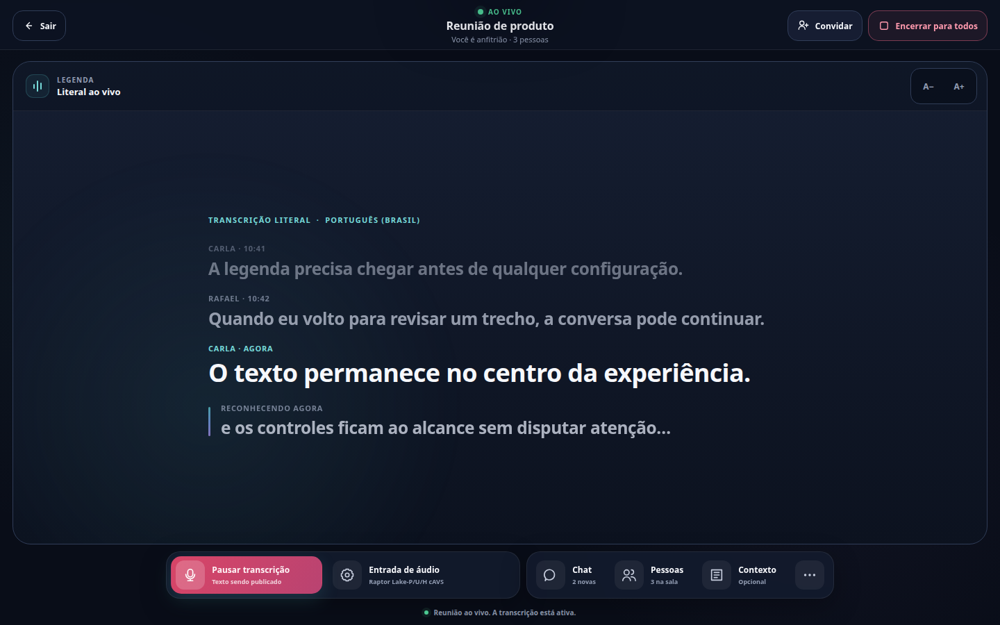
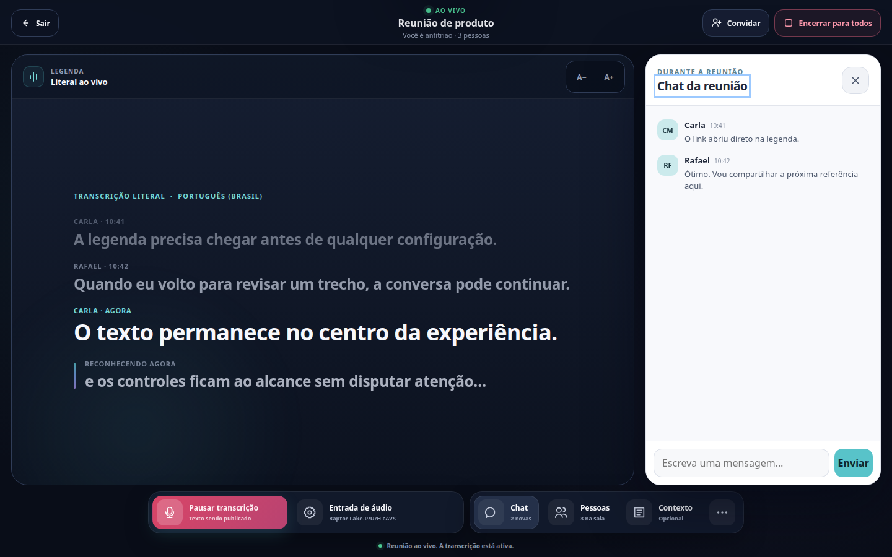
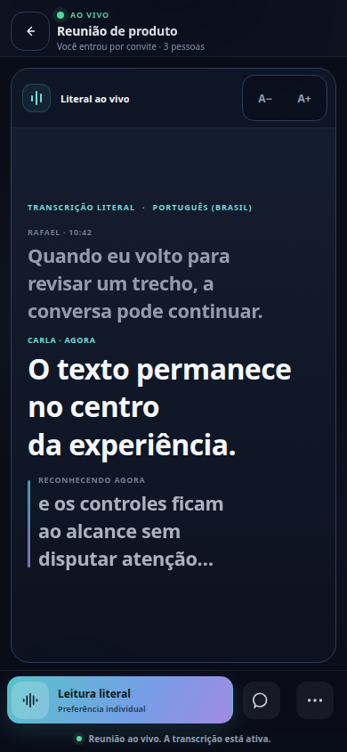
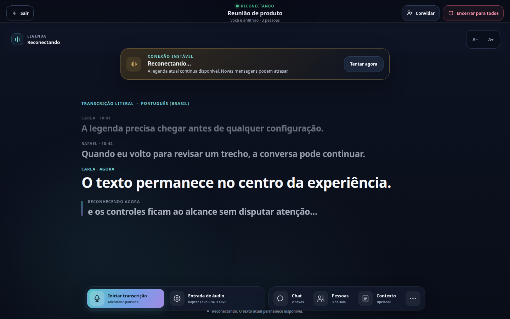
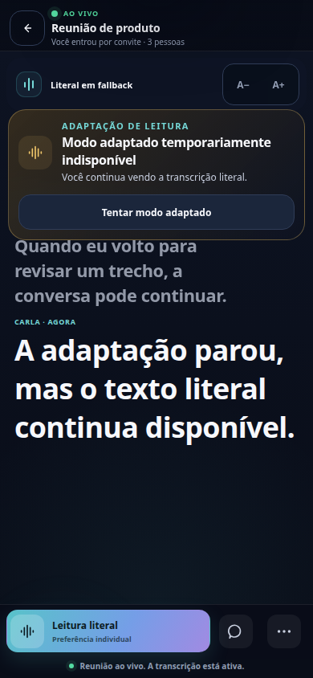
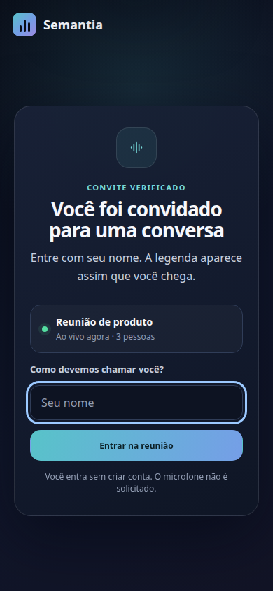

# Validação do protótipo — sala ao vivo acessível

> **Data:** 2026-07-31  
> **Branch:** `docs/ux-sala-acessivel`  
> **Card:** [Fechar a experiência UX/UI acessível das salas ao vivo](https://app.clickup.com/t/86e2j4uyj)  
> **Resultado técnico:** aprovado nos gates automatizados e na inspeção visual interna.  
> **Resultado humano:** pendente de revisão do Foyth e validação externa; não confundir com aprovação final.

## Escopo validado

Foram validados:

- 14 estados do contrato;
- Variante A, **Palco central**;
- Variante B, **Foco leitura**;
- papéis anfitrião e participante nos fluxos aplicáveis;
- desktop `1440 × 900`;
- tablet `1024 × 768`;
- mobile `390 × 844`;
- teclado, foco, dialogs, painéis, entrada por convite e encerramento;
- WCAG 2 A/AA, 2.1 AA e 2.2 AA via axe;
- `prefers-reduced-motion`;
- reflow em viewport CSS efetiva de `640 px`;
- ausência de rede externa, storage, Socket.IO e áudio real no protótipo.

## Ambiente real

- Brave Browser `150.1.92.144`;
- Firefox Playwright `153.0`;
- Node.js `v22.23.1`;
- `playwright-core@1.62.1`;
- `axe-core@4.12.1`;
- servidor estático local `python3 -m http.server`;
- Zen Browser: binário não disponível neste ambiente;
- Orca: instalado em `/usr/bin/orca`, mas não iniciado para evitar fala/interferência no desktop ativo.

## Matriz automatizada

A matriz integral executou:

```text
14 estados × 2 variantes × 3 viewports × 2 engines = 168 páginas
```

Resultado:

- **168/168 páginas carregadas**;
- **0 violações axe**, incluindo impactos minor, moderate, serious e critical;
- **0 overflow horizontal ou vertical da página**;
- **0 interseção entre aviso de contingência e legenda atual**;
- **0 alvo de botão/summary abaixo de 44 × 44 px**;
- **0 erro de console ou exceção JavaScript**;
- **0 request para origem externa**;
- **0 diferença de resultado entre Chromium e Firefox**.

A execução integral ocorreu de `2026-07-31T14:46:06.138Z` a
`2026-07-31T14:49:08.115Z`.

## Testes do núcleo

```bash
node --check prototipos/sala-ao-vivo/prototype.js
node --test prototipos/sala-ao-vivo/prototype.spec.mjs
```

Resultado:

```text
7 testes
7 passaram
0 falharam
```

Contratos cobertos:

1. exatamente 14 cenários;
2. fallback seguro para query desconhecida;
3. bloqueio de cenário exclusivo de anfitrião para participante;
4. fallback adaptada → literal;
5. reunião encerrada sem mutações;
6. presets de tamanho limitados;
7. deep link com parâmetros canônicos.

## Fluxos E2E nos dois browsers

Os mesmos testes passaram no Brave e no Firefox:

1. `Tab` inicial revela o skip link **Ir para a legenda**;
2. `Enter` move o foco ao palco;
3. chat abre e foca o título do painel;
4. `Escape` fecha o painel e devolve o foco a **Chat**;
5. encerramento abre dialog com foco inicial em **Cancelar**;
6. `Escape` fecha o dialog e devolve foco a **Encerrar para todos**;
7. anfitrião inicia e pausa transcrição simulada;
8. participante abre preferências no mobile;
9. participante troca de literal para adaptada sem controle de captura;
10. convite validado pede somente nome;
11. envio do nome entra direto na sala como participante;
12. reunião encerrada não apresenta controles mutáveis.

## Movimento e reflow

Com `prefers-reduced-motion: reduce`:

- `scroll-behavior` computado: `auto`;
- animação do ponto de presença: `none`;
- nenhuma animação contínua permanece ativa.

### Limite da validação de zoom

O Brave headless não aplicou o atalho de zoom do navegador: após cinco `Ctrl+=`, `innerWidth`,
`devicePixelRatio` e `visualViewport.scale` permaneceram inalterados.

Foi aprovado o reflow equivalente em viewport CSS de `640 px`:

```text
scrollWidth = 640
clientWidth = 640
```

Isso cobre a mudança de layout correspondente a 200% em uma viewport-base de 1280 px, mas **não é
registrado como teste manual real de zoom do navegador**. O zoom real a 200% permanece no gate humano.

## Inspeção visual adversarial

A inspeção usou capturas reais geradas pelo browser, não mocks de imagem.

### Achados corrigidos durante o loop

1. **Painel desktop não fechava com Escape**
   - Causa: `dialog.show()` não modal não recebe fechamento automático.
   - Correção: caminho explícito de teclado e retorno de foco.

2. **Variante A mobile excedia a viewport em 12 px**
   - Antes: `scrollHeight 856`, `clientHeight 844`.
   - Depois: `844 = 844`.

3. **Banner de fallback/reconexão cobria a legenda no mobile**
   - Correção: aviso participa do grid no mobile; não é overlay.

4. **Console do protótipo interceptava controles da reunião**
   - Correção: caixa fechada reduzida a `44 × 40` no header; expande somente quando aberta.

5. **Participante mobile não tinha ação primária explícita**
   - Correção: botão **Leitura literal/adaptada — Preferência individual**.

6. **Botões A−/A+ tinham 38 px em tablet/desktop**
   - Correção: mínimo de 44 px em todas as larguras.

7. **Barra participante quebrava “Mais” em uma segunda linha**
   - Correção: grid `1fr + 52 + 52`, preservando preferência, chat e mais na mesma linha.

### Resultado visual

Nenhum P0/P1 visual permaneceu após o segundo ciclo de capturas.

P2 que deve ser observado na revisão humana:

- o painel claro da Variante A produz contraste de superfície mais forte que o restante do produto;
- a Variante B exige disciplina maior para não sobrepor estados futuros ao transcript;
- texto ampliado pode reduzir o número de falas históricas visíveis, comportamento deliberado para
  preservar a fala atual.

## Evidências versionadas

### Variante A — anfitrião desktop



### Variante A — anfitrião com chat



### Variante A — participante mobile



### Variante B — anfitrião reconectando



### Variante B — participante em fallback literal



### Entrada por convite



## Recomendação técnica preliminar

Recomenda-se a **Variante A — Palco central** como base do handoff, sem declará-la aprovada.

Razões:

1. mantém a legenda inequivocamente principal;
2. painel desktop redimensiona o palco em vez de cobrir o texto;
3. modelo espacial é mais previsível para anfitrião e participante;
4. estados críticos exigem menos regras especiais;
5. migração a partir do frontend atual é incremental;
6. Variante B demandou correção específica para impedir sobreposição no mobile.

Elementos da Variante B que podem ser incorporados à A:

- palco sem moldura em telas estreitas;
- maior largura de leitura quando não há painel;
- barra inferior visualmente destacada, sem competir com a legenda.

## Gates humanos e externos pendentes

O protótipo **não pode ser declarado aprovado** antes de:

- [ ] Foyth revisar as duas variantes e aceitar uma direção;
- [ ] executar zoom manual real a 200% em browser gráfico;
- [ ] executar navegação manual com Orca/NVDA/VoiceOver sem interferir na sessão do usuário;
- [ ] validar tarefas e SEQ com pessoa surda ou intérprete, quando houver disponibilidade;
- [ ] registrar nome/papel, data, roteiro e resultados da validação externa;
- [ ] executar smoke no Zen real quando o browser estiver disponível.

A ausência de participante externo não deve ser substituída por uma afirmação simulada.

## Privacidade e isolamento

A inspeção confirmou que o protótipo:

- não usa `fetch`;
- não abre WebSocket;
- não usa `localStorage` nem `sessionStorage`;
- não solicita microfone;
- não carrega fonte, ícone, script ou imagem externa;
- usa somente conteúdo fictício e arquivos locais.
